# 10GB 显卡，一晚上跑通出图与视频

2026 年 10 月 29 日晚上，我在微信群里看到一篇文章。

文章讲怎么用 Krea2 在本地搭一套出图流程。主模型打底，叠人像 LoRA，用四段式提示词锁住人物，再从服装图鉴里挑搭配。步骤写得很完整。

但我真正想知道的问题，文章没有回答。

10GB 显存的显卡能不能跑？跑一张图要多久？会不会爆显存？

我决定不猜。用一个晚上，把这套流程在自己的机器上完整跑一遍。图片和视频，两条线都跑。

机器很普通：i7-13700KF、RTX 3080 10GB、32GB 内存、Windows 11。没有服务器，没有租卡，推理全部在本地。

先看结果。

- Qwen-Image 2.1：1024×1024 中文海报，14–18 秒一张，峰值显存 9.5GB。
- 参考图改图：25–27 秒。背景替换、文字改色都能按指令完成。
- Krea2 Turbo：832×1216 固定人设出图，8 步采样。模型加载后，约 81 秒一张。
- MiniMax H3：608×352、5.2 秒视频，48–55 秒出片。6.6 秒版本 66–73 秒。480×864 竖屏 103–126 秒。
- 全程没有 OOM，没有崩溃，没有按张计费。

下面是我这一晚的操作记录，以及真正踩过的坑。

## 一、环境：先确认只有一个后端

本地出图，第一步不是模型，是环境。

我用 ComfyUI 便携版，装在 D 盘，端口 8188。基础包来自魔搭，内置版本偏旧。我把它升级到 0.43.0，节点数超过一千。Qwen、Krea2、H3 需要的原生节点都在。

模型没有全塞进一个目录。D 盘放便携版自带的模型，E 盘放一个共享模型库。我用 `extra_model_paths.yaml` 把两边合并。便携版启动后能同时看到两批模型，不用搬几十 GB 的文件。

第一个坑在这里。

ComfyUI 只在启动时扫描模型目录。新下载的模型放进文件夹，下拉框不会自动出现。必须重启后端。

还有一个更隐蔽的问题。机器上装了桌面版时，8188 上跑的可能是另一个后端。你以为在下模型，其实下给了另一个实例。

判断方法很简单。看进程命令行，确认后端指向哪个目录。一次只开一个后端，10GB 显存经不起两个实例一起占。

日常启动我做成了一键脚本。双击后自动检测 8188。没跑就拉起后端，等就绪后打开 Comfy Desktop，点「远程连接」连上去。

桌面版只是个壳，干活的是便携版后端。关掉任务栏里那个最小化的黑色窗口，服务就停了。

## 二、Krea2：固定人设出图

Krea2 是 Krea AI 开源的文生图模型，约 129 亿参数，有 Base 和 Turbo 两个版本。Turbo 步数少、出图快，适合显存不宽裕的机器。

在 ComfyUI 里，它不是单个 checkpoint，而是三件套：主模型、文本编码器、VAE。三个文件合计 17.3GB，走国内镜像下载，大约 17 分钟。

官方模型仓库要登录才能下载，匿名访问不了。我换了 ComfyUI 官方的搬运仓库。文件按 ComfyUI 的目录结构组织好，不设门槛。

参数不要自创，照官方模板：

- 采样 8 步，CFG 1，euler / simple；
- 负向不用负向词，用 `ConditioningZeroOut`；
- LoRA 只挂模型侧，权重从 0.8 起步；
- 画布 832×1216，2:3 竖幅。

第一次跑要加载 12GB 主模型，看起来像卡住。其实是在读盘，大约 3 分钟。模型缓存后，一张图 81 秒。

我做了个公平对比。同一个种子 42，一张不挂 LoRA，一张挂 Ins 风人像 LoRA 0.8。差异很明显。

基线版偏写实摄影，人物素一点。LoRA 版五官更精致，蓝宝石更通透，纱质和配饰更华丽，整体更仙。

这跟群里的经验对上了：没加 LoRA，人要素一点；加了 LoRA，人物仙一点。

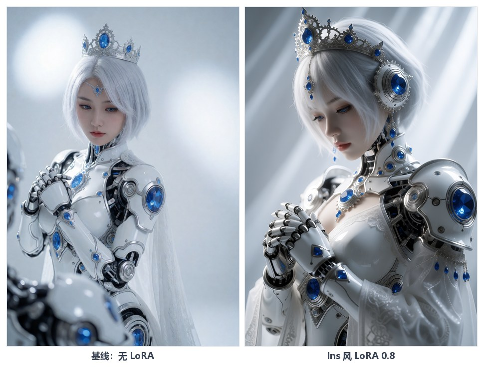

*同种子 42、同提示词，只换人像 LoRA*

但让这套流程能稳定出图的，不是 LoRA，是提示词结构。

文章里的四段式模板，我原样搬了过来：

- 【画面风格】镜头、光线、质感，固定；
- 【核心元素】人物长相、服装、配饰，固定；
- 【具体内容】动作、视线、前景背景，每次换；
- 【构图方式】半身或全身、机位、留白，每次换。

前两段锁住人物，后两段换场景。想换衣服，把新服装写进【核心元素】。想换姿势，改【具体内容】。表情不用找素材图，直接写「可爱脸」「害羞脸」「清冷脸」。这样人物跨图能保持一致，换题材只动后两段。

样本 A「机械姬」的提示词已经内置在工作流里，打开就能跑。银发蓝眼、白甲蓝宝石、低头交叠双手、前景虚化机械件，一张不差。

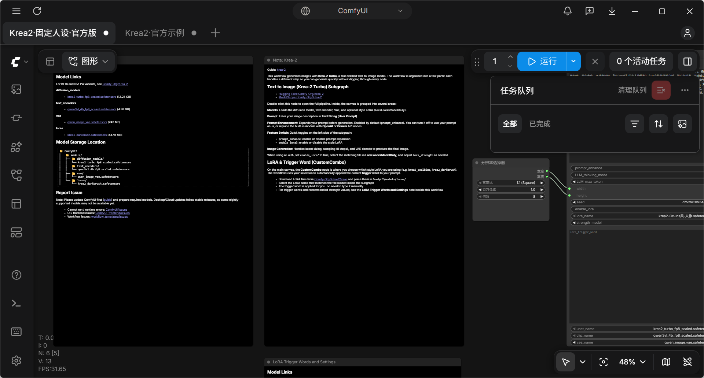

*ComfyUI 里的「Krea2·固定人设·官方版」：打开工作流点「运行」即可*

## 三、Qwen-Image：中文海报与改图

Krea2 负责人物。Qwen-Image 2.1 负责中文信息图。

三个文件合计 16.1GB，同样走 int8 量化，不需要自定义节点。

1024×1024 首测，三张图分别用了 17.9 秒、14.2 秒、14.0 秒，峰值显存 9,529MiB。中文「本地出图」四个字字形正确，没有乱码。这一点比很多模型都强。

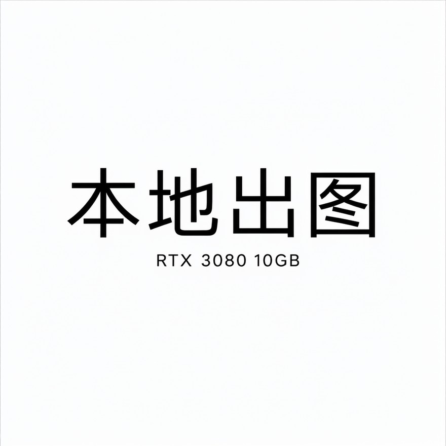

*1024×1024 首测，中文「本地出图」字形正确*

改图也好用。

我把首测海报丢进去，让它把白底换成深蓝到黑的渐变，同时保留文字、字体和排版。27 秒完成。背景换对了，文字也保住了。但指令要求「文字不变」，黑字留在深色背景上，对比度很低。

第二次，我把指令改成「文字改成白色，字体与排版完全不变」。25 秒，白字清晰锐利。

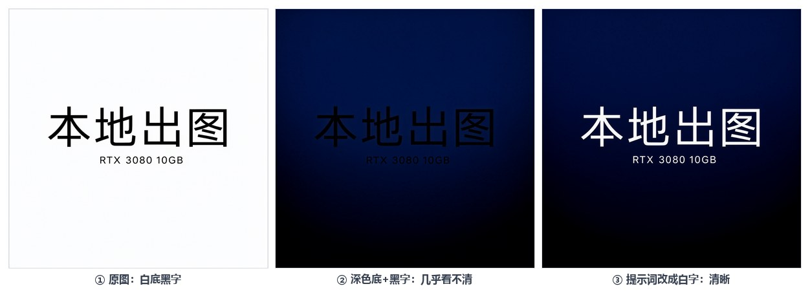

*只写「背景变色」会得到几乎看不清的黑字（中）；补上「文字改白」才可读（右）*

这件事给我一个改图原则：既要写清楚想改什么，也要写清楚想保留什么。只写「不变」，模型会严格执行，但结果不一定好看。

竖版也没问题。768×1344 出一张竖版海报，19.7 秒。再用改图把它变成深色渐变白字，27.2 秒。这两张后来成了 H3 竖屏视频的首尾帧。

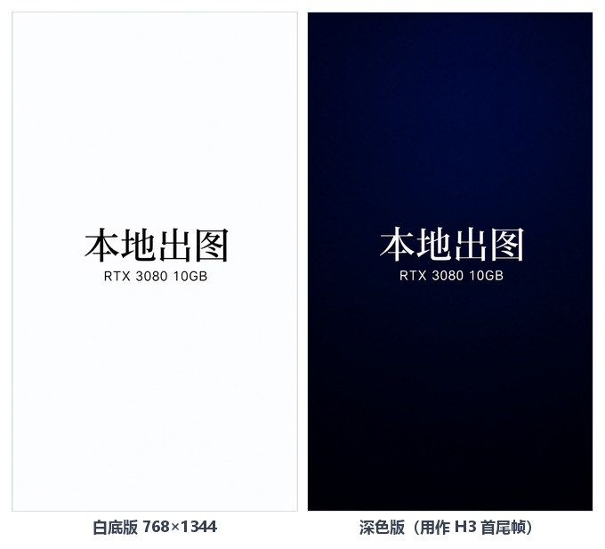

*768×1344 竖版：白底版与深色白字版，后者裁剪成 480×864 作视频首尾帧*

## 四、H3：首尾帧出视频

视频线用 MiniMax H3 的 FL2V 首尾帧模型，社区 W4A8 量化版。四个文件合计 20.1GB。另外装两个插件：ClipProj 负责文本投影，Spectrum 负责近似加速。

工作流不复杂。主模型进注意力后端，再进 Sigma Shift，然后进 Spectrum，最后进采样器。文本编码器接 ClipProj，再接首尾帧节点。采样结果解码，封装成 24fps 的 mp4。

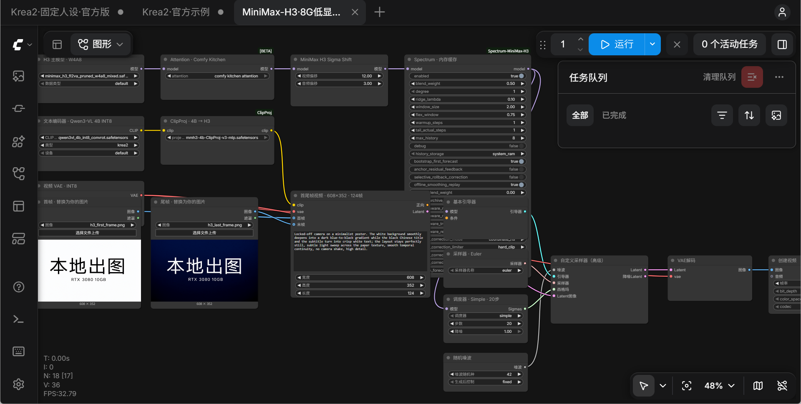

*ComfyUI 里的 H3 工作流：左边首尾帧输入，中间采样区，右边解码与视频封装*

基准参数是 608×352、124 帧、24fps、20 步，约 5.2 秒视频。

三条连跑，耗时 55.17、50.67、48.44 秒，峰值显存 9.2–9.6GB。模型一直驻留，没有重启，没有 OOM。

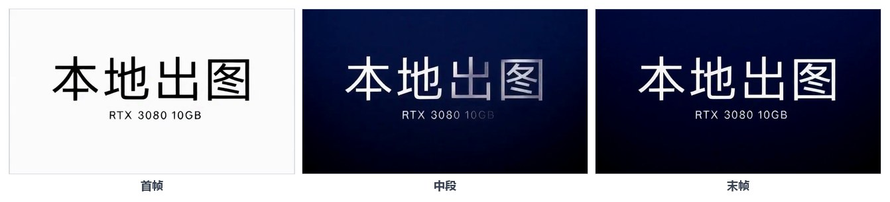

*608×352 / 124 帧首测：三帧布局稳定，白底黑字平滑过渡到深底白字*

把帧数从 124 加到 158，视频变成 6.6 秒。耗时只多 13–18 秒，显存峰值持平。这个档位性价比很高，适合做默认时长。

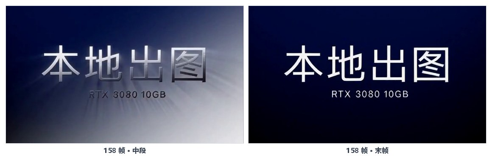

*158 帧 / 6.6 秒：只多 13–18 秒，显存持平*

分辨率提到 480×864，像素量差不多翻倍，耗时也翻倍到 103–126 秒，峰值显存 9.7GB。距 10GB 上限只剩 0.5GB。这是这张卡的可用上限区，再往上就要靠运气。

竖屏还有一个坑。

第一次我用横版首尾帧喂 480×864 画布。结果首帧被缩放，尾帧被居中裁剪，两侧文字直接没了。

这不是模型的问题，是输入适配的问题。正确做法是先用 Qwen 生成 768×1344 的竖版首尾帧，裁到 480×864，再喂给 H3。改完之后，构图正确，文字完整。

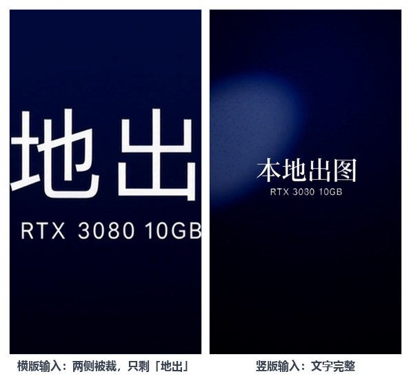

*左：横版首尾帧喂竖幅画布，两侧被裁只剩「地出」；右：竖版输入，文字完整*

质量方面，不同种子的差异比想象中大。有一次，种子 43 在第 70–90 帧出现密集白色噪斑。第 110 帧之后才恢复干净。同参数的种子 42 和 44 完全正常。

这属于去噪轨迹差异，Spectrum 会放大这种差异。正式出片前一定要预览中段帧。遇到噪斑就换种子重跑，不要只看首尾帧就导出。

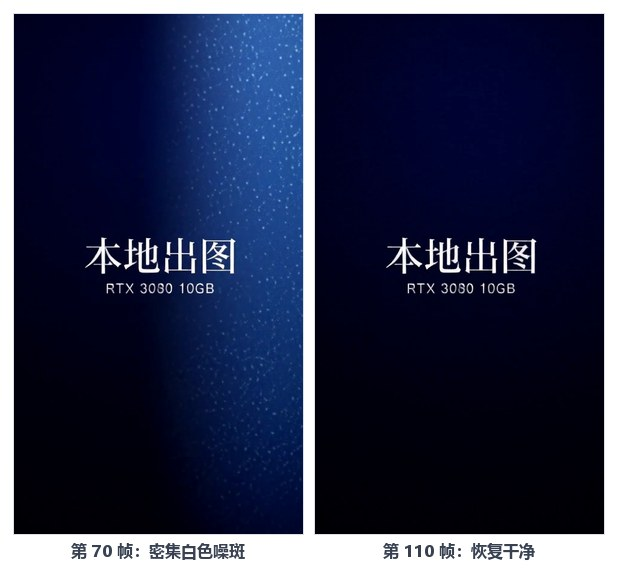

*seed 43：第 70 帧密集白色噪斑（左），第 110 帧恢复干净（右）*

## 五、四个真正花时间的问题

回头看，下载模型是最简单的一步。真正花时间的是下面四件事。

第一件：工作流打开一片空白。

我手写了一份工作流 JSON。节点和连线都在，但没有标题，没有参数。

查了半天才确认：这个前端版本不认手写的序列化格式。解决办法不是继续猜字段，而是一律以官方模板为底改。官方模板由前端自己生成，兼容性有保证。之后所有工作流都从官方模板改造，再没空白过。

第二件：模型下了却看不见。

原因有两个。一是 ComfyUI 启动时才扫描目录，后加的文件必须重启。二是机器上同时存在便携版和桌面版，8188 上跑的可能不是你以为的那个。先看进程，再看 yaml，最后才怀疑模型文件。

第三件：网络。

HuggingFace 直连基本超时，全部走国内镜像。官方仓库有下载门槛，就换 ComfyUI 的搬运仓库。

Comfy Desktop 提示「没有可安装的兼容构建」，不是程序坏了。是它拉取构建列表的三个域名都连不上。要么开代理，要么用「远程连接」连现成的便携版后端。

还有一条硬规则：同一个文件不要跨源续传。不同来源的同名文件大小可能一样，哈希却不同。换源必须整文件重下。

第四件：显存。

10GB 是个很尴尬的数字。图片 1024² 能跑，峰值 9.5GB。视频 480×864 能跑，只剩 0.5GB 余量。任何并行任务都可能把显存占满。所以，一次只开一个后端，跑图时别开游戏，分辨率一档一档试，每个配置连跑三条再定档。

## 六、适合谁，不适合谁

先说结论：本地 AI 不等于把云服务装到自己机器上。它的价值是让试错不再花钱。

云端按张、按秒计费。你每跑一张都要算钱，不敢乱试。本地没有单次成本。你可以为一个姿势跑二十张废图，可以为一个种子连跑三条，可以把 LoRA 权重从 0.5 试到 1.0。真正的生产力，往往来自试错次数。

它适合这些人：

- 需要批量出图、反复调风格的个人创作者；
- 对素材隐私敏感，不希望图片上传到云端的人；
- 愿意花一个晚上折腾环境，换取长期免费使用的人；
- 想理解文生图、图生视频到底怎么回事的人。

它不适合这些人：

- 需要 4K 商业大片、长视频、多人复杂动作的团队；
- 完全不想碰命令行和参数的人；
- 指望本地模型全面替代云端顶配的人。

10GB 是入门配置。能跑通，能出片，但余量很小。预算允许的话，24GB 显存会舒服很多。

许可证也要看清。Qwen-Image 2.1 是研究许可，商用需要换 Apache-2.0 的 20B 路线。Krea2 和 H3 的社区权重，也要逐个核对原模型和量化作者的条款。

## 七、下一步

这套环境已经稳定。接下来我想做三件事。

1. 把视频拉长。608×352 下试 175 帧、192 帧，找 10GB 卡的时长上限。
2. 把提示词库建起来。把好用的服装、姿势、场景存成结构化文件，脚本随机组合，批量出图。
3. 试 2K 重绘。H3 出 768P，再用重绘节点往上推，看看本地能走到哪一步。

如果你也想复刻，送你五句话：

- 先确认后端只有一个，模型目录挂对；
- 参数照官方模板，别自创；
- 一次只改一个变量，每个配置连跑三条；
- 视频先预览中段，再导出；
- 网络问题先找镜像，不要硬刚直连。

本地 AI 最好玩的地方，不是它现在有多强，而是它完全属于你。模型在你硬盘里，推理在你显卡上，提示词不出你的机器。你可以随时停下来，也可以一直跑下去。

这大概就是本地部署的意义。

---

*本文所有耗时与显存数据均来自 RTX 3080 10GB 实机测试。不同硬件、驱动与模型版本下，结果会有差异。*

## 附：封面与分享图

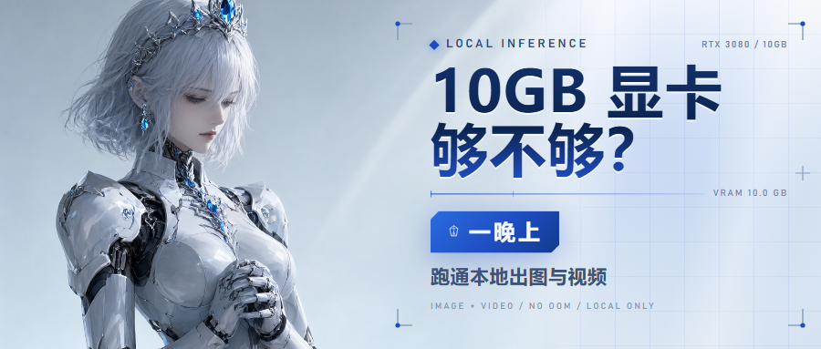

*封面 900×383：Qwen-Image 2.1 本地生成插画，再用 HTML 模板排版*

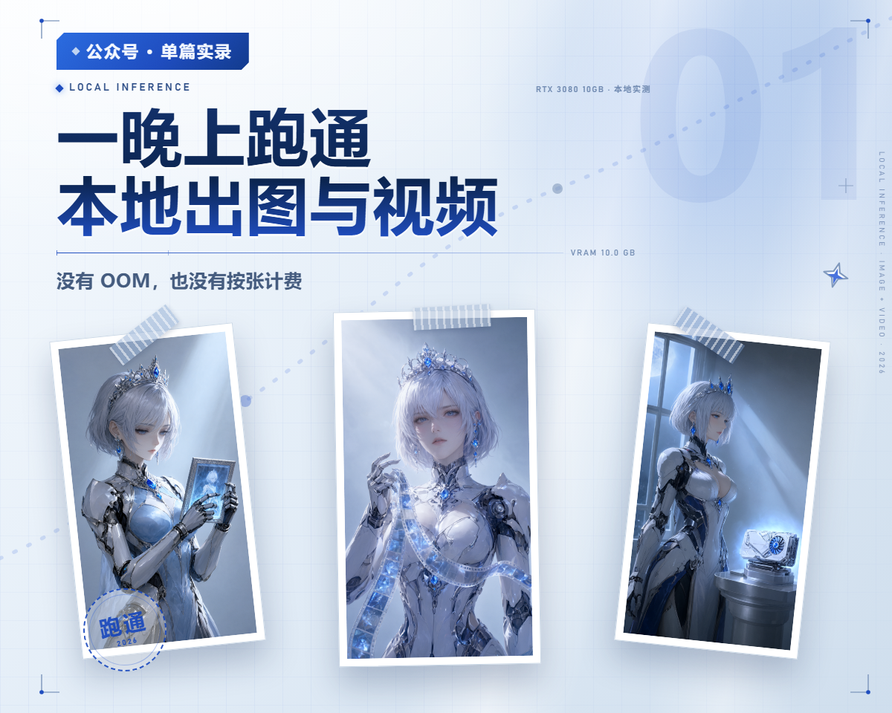

*分享图 1200×960：三张插画均由 Qwen-Image 2.1 本地生成*
