# 本地 AI 图像 / 视频工作流 · 实操手册

> 适用机器：Windows 11 · i7-13700KF · RTX 3080 10GB · 32GB RAM · NVIDIA 621.01（CUDA 13.5）
> 记录时间：2026-10-29 ~ 2026-10-30
> 覆盖：ComfyUI 0.43.0 · Qwen-Image 2.1 · Krea2 Turbo · MiniMax H3 FL2V
> 说明：本文只记录环境、模型、参数、实测数据与排障过程，不涉及代码托管、仓库创建与推送等操作。

---

## 0. 十秒速查

| 想做什么 | 用哪个模型 | 入口 | 本机实测 |
|---|---|---|---|
| 中文海报 / 文生图 | Qwen-Image 2.1 int8 | API 工作流 `qwen21-*` | 1024²，14–18 s，峰值 9,529 MiB |
| 参考图改图 | Qwen-Image 2.1 image_edit | API 工作流 `qwen21-edit-*` | 1024²，25–27 s |
| 竖版人像 / 海报 | Qwen-Image 2.1 | 768×1344 | 19.7 s |
| 固定人设批量出图 | Krea2 Turbo FP8 + 人像 LoRA | UI 工作流 / `krea2-generate.mjs` | 832×1216，8 步，缓存后约 81 s |
| 5 秒图生视频 | MiniMax H3 FL2V | H3 工作流 | 608×352/124 帧，48–55 s |
| 6.6 秒视频 | MiniMax H3 FL2V | 同上，158 帧 | 66–73 s |
| 竖屏 5 秒视频 | MiniMax H3 FL2V | 480×864/124 帧 | 103–126 s，峰值 9.7 GB |

日常最短路径：

1. 双击 `D:\桌面\启动ComfyUI.bat`（自动拉起后端 8188，并打开 Comfy Desktop）。
2. 浏览器开 `http://127.0.0.1:8188`，或在 Desktop 里点「远程连接」→ `127.0.0.1:8188`。
3. 左侧「工作流」面板选现成工作流，改提示词 / 种子，点「运行」。

---

## 1. 环境总览

### 1.1 硬件与系统

| 项目 | 实际配置 | 说明 |
|---|---|---|
| GPU | RTX 3080 10GB（10,240 MiB） | 所有路线都按 10GB 上限设计，余量常年只有 0.5–1 GB |
| CPU | i7-13700KF | 模型加载、VAE 解码、视频封装都够用 |
| 内存 | 32GB DDR4-3600 | ComfyUI 分层加载的兜底内存，不建议再关虚拟内存 |
| 系统 | Windows 11 22631 | — |
| 驱动 | NVIDIA 621.01（2026-10-21 WHQL），CUDA 13.5 | H3 要求 ≥580，已满足 |

### 1.2 软件栈

| 组件 | 版本 / 位置 | 备注 |
|---|---|---|
| ComfyUI 后端 | `D:\LocalAI\ComfyUI_windows_portable`，v0.43.0，端口 8188 | 唯一实际干活的后端 |
| Python / PyTorch | 3.13.14 / 2.13.0+cu130（便携版内置） | 不需要系统 Python |
| 前端 / 模板 | frontend 1.57.4、templates 0.11.97 | 工作流 JSON 兼容性以官方模板为准 |
| Comfy Desktop | `E:\application\Comfy Desktop` 1.1.8 | 只当界面壳，通过「远程连接」连 8188 |
| 一键启动器 | `D:\桌面\启动ComfyUI.bat` | 检测 8188 → 启动后端 → 等待就绪 → 打开 Desktop |

安装来源与升级路径：

- 基础包来自魔搭数据集 `taoluban/comfyui-portable`（内置 ComfyUI 0.33.1）。
- 通过 `gh-proxy.com` 拉取 ComfyUI tag `v0.43.0` 并切换，依赖升级到 frontend 1.57.4 / templates 0.11.97。
- 升级后 `/system_stats` 返回 0.43.0，`/object_info` 共 1,018 个节点，含 `TextEncodeQwenImage21`、`EmptyMiniMaxH3LatentAV`、`MiniMaxH3ImageToVideo` 等原生节点。
- 这是「魔搭旧版 + git 升级」组合，不等同于官方 0.43.0 便携包的原生构建；若出现版本相关异常，优先换官方 v0.43.0 便携包。

### 1.3 目录地图

| 路径 | 内容 |
|---|---|
| `D:\LocalAI\ComfyUI_windows_portable\ComfyUI` | 后端程序、自定义节点、输入、输出、工作流 |
| `D:\LocalAI\ComfyUI_windows_portable\ComfyUI\models` | D 盘原有模型（Qwen、H3 等） |
| `E:\Comfy-Desktop\ComfyUI-Shared\models` | E 盘共享模型库（Krea2 三件套、LoRA、墨玉 AIO） |
| `...\ComfyUI\extra_model_paths.yaml` | 把 E 盘模型目录合并进便携版 |
| `...\ComfyUI\output` | 图片输出 |
| `...\ComfyUI\output\video` | 视频输出 |
| `...\ComfyUI\input` | 首尾帧、参考图 |
| `...\ComfyUI\user\default\workflows` | UI 工作流库 |
| `E:\mm3\deploy\qwen-image` | 图像部署包：README、manifest、下载脚本 |
| `E:\mm3\deploy\minimax-h3` | 视频部署包：README、manifest、下载脚本 |
| `D:\LocalAI\work` | API 工作流 JSON、实测日志、复现文件 |
| `E:\mm3\krea2-generate.mjs` | Krea2 命令行出图脚本 |
| `E:\mm3\krea2-out` | Krea2 命令行输出 |
| `E:\mm3\HANDOFF.md` | 全项目验收记录与变更日志 |

### 1.4 模型目录合并（双目录共存）

`D:\LocalAI\ComfyUI_windows_portable\ComfyUI\extra_model_paths.yaml`：

```yaml
# 让便携版 ComfyUI 同时读取 E 盘 ComfyUI Desktop 共享模型目录
krea2_shared:
    base_path: E:/Comfy-Desktop/ComfyUI-Shared/models/
    checkpoints: checkpoints
    diffusion_models: diffusion_models
    text_encoders: text_encoders
    vae: vae
    loras: loras
    upscale_models: upscale_models
```

要点：

- ComfyUI 只在启动时扫描模型目录；新增模型后必须重启后端才会出现在下拉框。
- 改完 yaml 先确认 `/queue` 为空再重启，避免打断正在跑的任务。
- 便携版和 Desktop 后端如果同时开，会抢同一块 10GB 显存——一次只开一个。

### 1.5 启动与停止

`启动ComfyUI.bat` 的逻辑：

1. `curl` 检测 8188 是否已就绪；已就绪直接跳到第 3 步。
2. 未就绪则以最小化窗口启动：
   `python_embeded\python.exe -s ComfyUI\main.py --windows-standalone-build`
   最多等待 2 分钟。
3. 打开 `E:\application\Comfy Desktop\Comfy Desktop.exe`，手动点「远程连接」→ `127.0.0.1:8188`。

停止服务：关闭任务栏里标题带 **ComfyUI Backend 8188** 的那个最小化窗口即可，不要用任务管理器强杀。

其他规则：

- 双击后如果提示端口被占，说明已有一个实例在跑，直接开浏览器用。
- 后端重启后，浏览器 / Desktop 页面要点一次刷新（⟳ 或 Ctrl+R），否则可能拿不到新的节点定义和模型列表。
- 日志在 `D:\LocalAI\ComfyUI_windows_portable\comfyui.log`，出问题先看最后 30 行。

---

## 2. 模型清单与下载

### 2.1 Qwen-Image 2.1（图像）

合计 **3 个文件，17,283,091,112 字节（16.10 GiB）**。

| 文件 | 字节 | 放入目录 |
|---|---|---|
| `qwen_image_2.1_int8_convrot.safetensors` | 7,256,783,064 | `models\diffusion_models\` |
| `qwen3vl_8b_int8_convrot.safetensors` | 9,350,798,360 | `models\text_encoders\` |
| `qwen_image_2.1_vae_bf16.safetensors` | 675,509,688 | `models\vae\` |

下载命令（ModelScope 主源，约 17 分钟，峰值 23 MB/s）：

```powershell
powershell -NoProfile -ExecutionPolicy Bypass -File E:\mm3\deploy\qwen-image\download-qwen-image.ps1 `
  -Bundle recommended -TargetRoot "D:\LocalAI\ComfyUI_windows_portable\ComfyUI"
```

说明：

- 一个模型同时覆盖文生图与参考图编辑，不需要先二选一。
- int8 路线不需要任何自定义节点，ComfyUI 原生加载器即可。
- 许可证为 **Qwen Research License（仅非商业）**；商用需改走 20B Apache-2.0 路线（见部署包 README 第 4.2 节）。

### 2.2 Krea2 Turbo（图像）

合计 **三件套 17.3 GB**，另有 3 个人像 / 风格 LoRA 和 1 个墨玉 AIO 单文件版。

| 文件 | 大小 | 放置目录 |
|---|---|---|
| `krea2_turbo_fp8_scaled.safetensors` | 12.24 GB | `diffusion_models\` |
| `qwen3vl_4b_fp8_scaled.safetensors` | 4.88 GB | `text_encoders\` |
| `qwen_image_vae.safetensors` | 0.24 GB | `vae\` |
| `krea2-Cc-Ins风-人像.safetensors` | 343 MB | `loras\` |
| `krea2-Cc风情万种-人像.safetensors` | 343 MB | `loras\` |
| `krea2-Cc-MJ-风格滤镜.safetensors` | 343 MB | `loras\` |
| `Krea2-turbo-Ink_Jade-AIO-V1-fp8.safetensors`（墨玉三合一） | 22.3 GB | `checkpoints\` |

下载渠道与经验：

- 官方仓库 `krea/Krea-2-Turbo` 是 **gated（需登录）**，匿名下不了；改用 ComfyUI 官方搬运仓库 **`Comfy-Org/Krea-2`**，文件已按 ComfyUI 目录组织。
- 走 `hf-mirror.com` 镜像，三个文件约 17 分钟、17 MB/s：

```bash
base="https://hf-mirror.com/Comfy-Org/Krea-2/resolve/main"
# diffusion_models/krea2_turbo_fp8_scaled.safetensors
# text_encoders/qwen3vl_4b_fp8_scaled.safetensors
# vae/qwen_image_vae.safetensors
```

- 校验方式：文件大小与源站逐字节一致 + safetensors 前 8 字节是合法长度值（不是网页内容）。
- 该仓库还自带 10 个官方风格 LoRA（复古动漫、柔和水彩、霓虹雨窗等），需要时按同名路径下载即可。

### 2.3 MiniMax H3 FL2V（视频）

合计 **4 个文件，21,590,132,744 字节（20.11 GiB）**。

| 文件 | 字节 | 来源 |
|---|---|---|
| `minimax_h3_fl2va_pruned_w4a8_mixed.safetensors` | 12,540,858,008 | 魔搭（Kijai 镜像） |
| `qwen3vl_4b_int8_convrot.safetensors` | 5,374,169,456 | hf-mirror |
| `mmh3-4b-ClipProj-v3-mlp.safetensors` | 503,434,368 | hf-mirror |
| `minimax_h3_video_vae_int8_convrot.safetensors` | 3,171,670,912 | 魔搭 |

放入目录：主模型 `diffusion_models\`，文本编码器 `text_encoders\`，投影矩阵 `clip_projections\`，VAE `vae\`。

下载命令（混合源，魔搭优先，hf-mirror 兜底，并校验哈希）：

```powershell
powershell -NoProfile -ExecutionPolicy Bypass -File E:\mm3\deploy\minimax-h3\download-minimax-h3.ps1 `
  -ModelsRoot "D:\LocalAI\ComfyUI_windows_portable\ComfyUI\models" -HfMirror -VerifyHash
```

插件（两个，均通过 `gh-proxy.com` 获取）：

| 插件 | 版本 | 作用 |
|---|---|---|
| `ComfyUI-ClipProj` | 0.1.13 | 提供 `ClipProjApply`，把 4B 文本编码器投影到 H3 需要的维度 |
| `ComfyUI-Spectrum-MiniMax-H3` | 0.2.29 | 提供 `SpectrumApplyMiniMaxH3`，近似加速，会改变去噪轨迹 |

两个插件依赖为空，不需要额外 pip 安装；装完重启后端，`/object_info` 能看到 `ClipProjApply` 与 `SpectrumApplyMiniMaxH3` 即成功。

### 2.4 下载渠道规则（本机网络）

| 渠道 | 用途 | 实测 |
|---|---|---|
| ModelScope（魔搭） | 大权重首选 | 约 18–26 MB/s，最稳 |
| hf-mirror.com | 魔搭无镜像时 | 约 5–17 MB/s |
| gh-proxy.com | GitHub 仓库 / tag | 直连 GitHub 不可用时可用 |
| HuggingFace 直连 | 基本不可用 | 超时 |
| 桌面版 Comfy 构建服务 | 不可用 | `desktop.comfy.org` / `repo.comfy.org` / `launch.comfy.org` 全部超时 |

两条硬规则：

1. **同一文件不要跨源续传**。Kijai 与 starsfriday 的同名 H3 文件大小相同但哈希不同，换源必须整文件重下。
2. 下载脚本只负责下载、不安装；先核对大小，再核对 SHA-256（附录 B）。

---

## 3. 图像线 A：Qwen-Image 2.1

### 3.1 文生图参数

按官方模板 `image_qwen_image_2_1_t2i` 的子图构造 API 工作流：

- 链路：`UNETLoader → QwenImage21Cache(auto/default) → KSampler`
- 文本编码：`TextEncodeQwenImage21`，`resolution=1024`，VAE 已接
- 负向提示词：空
- 提示词增强：`refine_prompt=off`（PE 模型未下载，不影响基础出图）
- 采样：25 步、CFG 1.0、euler / simple、denoise 1.0
- 画布：`EmptyLatentImage 1024×1024×1`
- 保存：`SaveImage`，前缀 `Qwen21_*`

首测提示词：

```text
一张极简海报，白色背景，中央黑色中文大字“本地出图”，下方小字“RTX 3080 10GB”，平面设计，高清，边缘干净
```

首测结果（种子 12345 / 12346 / 12347）：

| 种子 | 耗时 | 采样速度 | 峰值显存 | 结果 |
|---|---|---|---|---|
| 12345 | 17.9 s（含首次加载） | 约 1.9 it/s | 9,529 MiB | 中文“本地出图”字形正确、无乱码 |
| 12346 | 14.2 s | — | — | 正常 |
| 12347 | 14.0 s | — | — | 正常 |

复现文件：`D:\LocalAI\work\qwen21-first-test-prompt.json`、`qwen21-run-12346.json`、`qwen21-run-12347.json`。

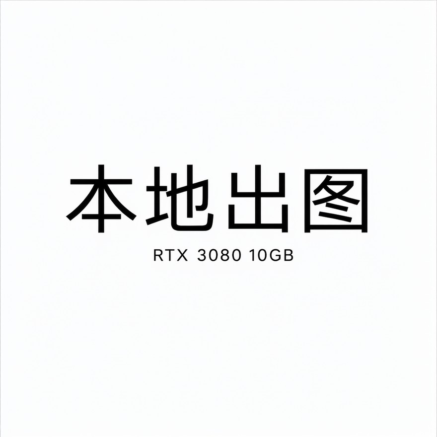

*图 3-1　Qwen-Image 2.1 首测（1024×1024，seed 12345）：中文“本地出图”字形正确、无乱码*

### 3.2 参考图编辑（image_edit）

按模板 `image_qwen_image_2_1_image_edit` 构造：

- 单图输入走 `images.image_1`；
- latent 取 `TextEncodeQwenImage21` 的 latent 输出（跟随参考图尺寸）；
- 其余参数同文生图：25 步、CFG 1.0、euler/simple、denoise 1.0、resolution 1024。

输入图：把首测海报复制为 `ComfyUI\input\qwen21_poster_ref.png`。

第一次指令（背景替换）：

```text
把背景从白色换成深蓝色到黑色的渐变，保留“本地出图”和“RTX 3080 10GB”两段文字、字体与排版完全不变，文字保持清晰，整体仍为极简海报
```

结果：27.1 s，峰值 9,186 MiB，背景替换与文字保真都符合指令。但由于指令要求“文字不变”，文字仍是黑色，在深色背景上对比度偏低——这是指令约束的结果，不是模型缺陷。

第二次指令（文字变白）：

```text
文字改成白色，字体与排版完全不变，文字保持清晰锐利
```

结果：25.2 s，文字变为白色、清晰可读，字形与排版保持。产物 `Qwen21_edit_white_test_00001_.png`，复现文件 `D:\LocalAI\work\qwen21-edit-white-test.json`。

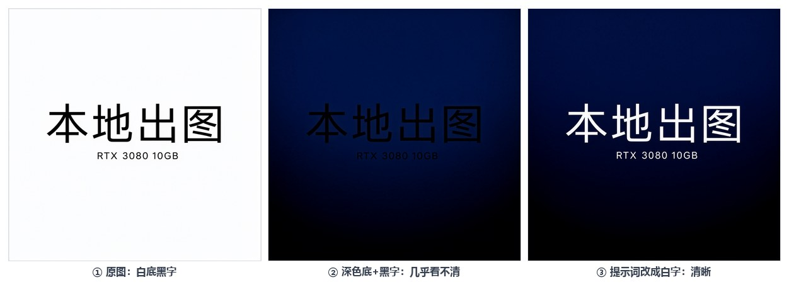

*图 3-2　参考图编辑：只要求“背景变色”会得到黑字压深底（②，几乎看不清）；把“文字改白”写进指令后才可读（③）*

经验：**改图时要把“想改的”和“想保留的”都写清楚**；只写“不变”会得到低对比度的正确但不好看的结果。

### 3.3 竖版 768×1344

用于给 H3 制作竖屏首尾帧：

- 文生图 768×1344，seed 2026，19.7 s → `Qwen21_portrait_white_00001_.png`
- image_edit 改深色渐变 + 白字，27.2 s → `Qwen21_portrait_dark_00001_.png`
- 后续处理：居中裁剪 746×1344，再缩放到 480×864，作为 H3 的首尾帧。

复现文件：`D:\LocalAI\work\qwen21-portrait-white.json`、`qwen21-portrait-dark.json`。

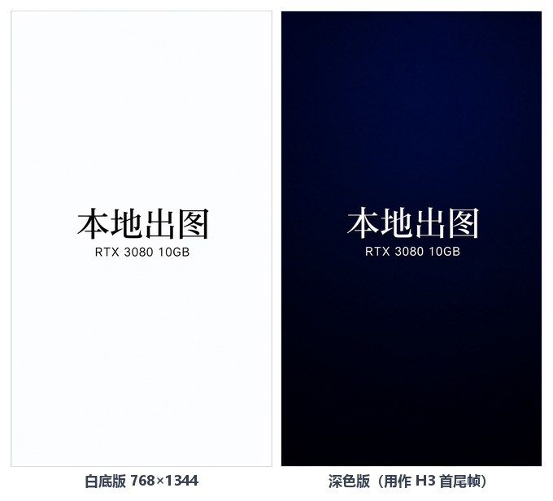

*图 3-3　竖版 768×1344：白底版（左）与编辑后的深色白字版（右），后者居中裁剪到 480×864 作 H3 首尾帧*

### 3.4 Qwen 使用要点

- 中文文字能力强，海报、标题、字幕类需求优先用它。
- 10GB 卡先跑 1024²，不要直接上 2048²；2048 未实测。
- 峰值约 9.5 GB，跑图时不要并行其他 GPU 任务。
- 竖版用 768×1344，比例接近 9:16，适合后续裁成 480×864。
- 商用需换 20B Apache-2.0 路线（Qwen-Image + Edit-2509 GGUF Q2_K），不要用 2.1 做商业交付。

---

## 4. 图像线 B：Krea2 Turbo 固定人设

### 4.1 定位

Krea AI 开源的文生图模型，约 129 亿参数，Base / Turbo 两版。Turbo 步数少、出图快，适合 10GB 卡。ComfyUI 里是**分体模型**（主模型 + 文本编码器 + VAE），不是单个 checkpoint；墨玉 AIO 才是单文件三合一。

### 4.2 官方模板参数（照抄，不要自创）

来自 ComfyUI 官方模板 `image_krea2_turbo_t2i.json`：

| 项目 | 值 |
|---|---|
| 主模型 | `krea2_turbo_fp8_scaled.safetensors` |
| 文本编码器 | `qwen3vl_4b_fp8_scaled.safetensors`，CLIPLoader 类型必须选 **`krea2`** |
| VAE | `qwen_image_vae.safetensors` |
| LoRA 节点 | `LoraLoaderModelOnly`（只挂模型侧），权重 0.8 起步 |
| 采样 | **8 步、CFG 1、euler / simple、denoise 1.0** |
| 负向 | `ConditioningZeroOut`（把正向条件清零），**不要**接普通负向词 |
| 画布 | 832×1216（2:3 竖幅） |
| 分辨率入口 | 官方模板外层 `ResolutionSelector`，竖幅选 2:3 类预设 |

三条铁律：

1. CFG 必须 1。设 3 不会“更听话”，只会劣化。
2. 负向用 `ConditioningZeroOut`，不是负向提示词。
3. 不需要 AuraFlow / lumina2 那套采样调参节点；链路就是 UNET →（LoRA）→ KSampler。

### 4.3 两条出图通道

**UI（日常）**

工作流库主用「**Krea2·固定人设·官方版**」：官方 Turbo 模板改造，样本 A 提示词已填、云端提示词增强已关、Ins 风 LoRA 已挂 0.8、种子 42 固定。

操作要点：

- 双击大节点可进入**子图**看内部实现，参数已配好，看懂即可，别乱改。
- 对比有无 LoRA：选中 LoRA 节点按 **Ctrl+B** 旁路。
- 换分辨率：改外层 `ResolutionSelector`，不要直接改子图里的 latent。
- 「Krea2·官方示例」留作诊断参照；它右侧弹的 `krea2_darkbrush` 缺失警告直接无视，内置下载按钮走 HF 直连，会卡死。

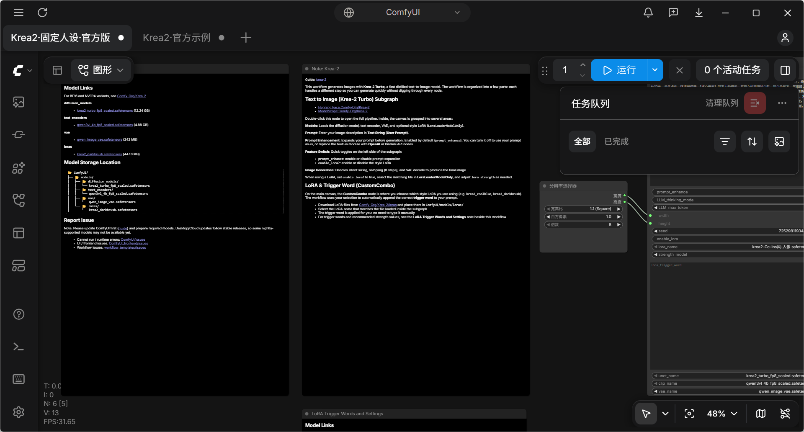

*图 4-1　ComfyUI 中的「Krea2·固定人设·官方版」：画布上是封装好的子图节点，右下角为分辨率选择器；右上任务队列显示 0 个活动任务*

**命令行（批量 / 复现）**

```bash
node E:\mm3\krea2-generate.mjs <nolora|lora> <seed> <输出名>
# 例：
node E:\mm3\krea2-generate.mjs lora 42 krea2_sampleA_insLora
```

- 脚本内置样本 A 提示词、832×1216、8 步、CFG 1、euler/simple、ConditioningZeroOut。
- 输出落在 `E:\mm3\krea2-out\<输出名>.png`。
- 换提示词需改脚本里的 `PROMPT_A`，或走 UI / API。

### 4.4 实出对比（同种子，唯一变量 = LoRA）

| 版本 | 种子 | 分辨率 | 耗时 | 观感 |
|---|---|---|---|---|
| 基线（无 LoRA） | 42 | 832×1216 | 首跑约 3 分钟（含 12 GB 模型加载） | 偏写实摄影感，人物“素”一点 |
| Ins 风 LoRA 0.8 | 42 | 832×1216 | 81 s（模型已缓存） | 五官更精致、蓝宝石更通透、纱质与配饰更华丽，整体更“仙” |

样图：`krea2_sampleA_base_00001_.png`、`krea2_sampleA_insLora.png`。

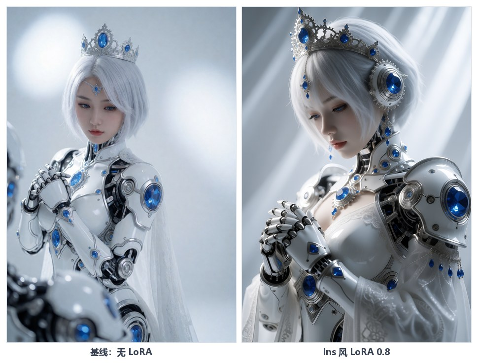

*图 4-2　同种子 42、同提示词，唯一变量是人像 LoRA：右图五官、蓝宝石与纱质明显更精致*

结论与群内经验一致：**同种子下 LoRA 差异非常明显**；画人务必挂人像 LoRA，风格滤镜可以串联，权重 0.8 起步。

### 4.5 四段式提示词方法

| 段 | 作用 | 换不换 |
|---|---|---|
| 【画面风格】 | 镜头、光线、质感（50mm、f/2.8、体积光…） | 固定 |
| 【核心元素】 | 人物长相 + 服装 + 配饰，即“固定人物模板” | 固定 |
| 【具体内容】 | 动作、视线、前景背景、场景光 | 每次换 |
| 【构图方式】 | 半身/全身、机位、留白 | 每次换 |

换题材只动后两段；换服装时把新服装描述写进【核心元素】，替换原服装部分；表情不用找素材图，直接写“可爱脸 / 害羞脸 / 清冷脸”。全身服装上身展示类，改用分层式：主体 → 表情 → 服装姿势 → 背景光线 → 构图 → 质感。

样本 A「机械姬」全文（已内置在工作流与脚本中）：

```text
【画面风格】全画幅写实摄影，50mm定焦，f/2.8，光圈优先，精准单点对焦锁定面部，科幻冷调柔光，极致锐利清晰，体积光，柔焦虚化，环境光遮蔽。【核心元素】固定人物模板：东亚女性鹅蛋脸白皙，银白色短发，蓝眼睛，红润嘴唇，精致妆容，机械姬；白色机械装甲，金属质感，镶嵌蓝宝石，颈部与手臂露出机械结构，白色薄纱披肩，银色华丽头冠镶蓝宝石齿轮，服装与配饰物理空间绑定不可分离；本段白色科幻空间柔和侧光。【具体内容】人物身体微侧，双手交叠胸前，低头看胸前蓝宝石，视线向下，表情沉静；前景虚化机械零件，中景白色空间，背景柔光光斑；顶侧柔光，环境光遮蔽，阴影过渡柔和，50mm透视自然，人物与空间关系真实。【构图方式】半身（medium shot），微俯正面偏侧，对角线构图，人物居中偏左，右侧留白。
```

### 4.6 换装、姿势与参考库

- 蓝熙衣装×姿势图鉴：`lanxi1023.com/costume.html`，点「随机生成」抽一套。
- 玄鸟图鉴源码：`github.com/vculjp/ai-reference-gallery`，clone 到本地就是离线图库。
- 拍片哥女装库：`github.com/paipiange/nvzhuang`。
- 选定后：服装描述 →【核心元素】，动作/姿势/场景 →【具体内容】，其余两段不动。
- 想把常用组合沉淀下来，就存成 `prompts.json`（服装 + 姿势两条字段），写个小脚本随机抽取拼进模板。

### 4.7 墨玉 AIO 单文件线

- 文件：`Krea2-turbo-Ink_Jade-AIO-V1-fp8.safetensors`，22.3 GB，放 `checkpoints\`。
- 用法：`Load Checkpoint` 一个节点同时输出 MODEL / CLIP / VAE，原来的三个独立加载器可以删掉。
- 参数：先按 8 步 / CFG 1 / euler / simple 试；若发糊或过饱和，再把 CFG 提到 2–3.5 对比。
- 定位：免折腾的通用底模、备用底牌，与三件套二选一即可出图，LoRA 通用。

### 4.8 Krea2 易错点

| 现象 | 原因 | 处理 |
|---|---|---|
| 出图全崩 / 色彩异常 | CLIPLoader 类型选成 `lumina2` | 必须选 `krea2` |
| VAE 解码报错或画面发灰 | VAE 选成 `minimax_h3_video_vae` | 图片必须用 `qwen_image_vae` |
| 采样器红框 / 参数无效 | 多接了 AuraFlow 采样节点 | 删掉，Krea2 不需要 |
| 画面劣化 | CFG 设了 3 | 回到 CFG 1 + ConditioningZeroOut |
| 新 LoRA / 模型不出现 | 后端没重启 | 重启后端并刷新页面 |

---

## 5. 视频线：MiniMax H3 FL2V

### 5.1 工作流链路

参照社区 `MiniMax_H3_FL2V_8GB_VRAM.json`（18 节点）改写为 API 工作流：

```text
UNETLoader
  → ModelAttentionBackend(comfy kitchen attention)
  → MiniMaxH3SigmaShift(12.0 / 3.0)
  → SpectrumApplyMiniMaxH3(默认参数)
  → BasicGuider

CLIPLoader(type=krea2)
  → ClipProjApply(v3-mlp)
  → MiniMaxH3ImageToVideo（接 first_frame / last_frame）

KSampler: euler + simple, 20 步, denoise 1.0
  → VAEDecode → CreateVideo(24fps) → SaveVideo(prefix video/...)
```

注意：社区 JSON 里 `BasicScheduler` 的 `model` 未连线但节点必填，本地接 Spectrum 节点输出，其余保持默认。

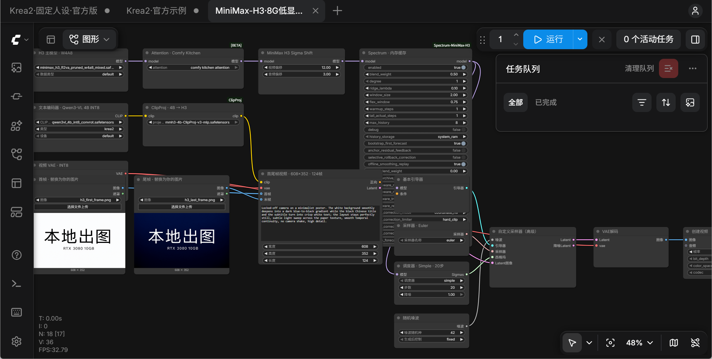

*图 5-1　ComfyUI 中的 H3 工作流：左侧首尾帧输入，中间主模型 → Attention → Sigma Shift → Spectrum → 采样器，右侧 VAE 解码与视频封装*

### 5.2 基准参数

| 参数 | 值 |
|---|---|
| 分辨率 | 608×352 |
| 帧数 | 124（124 = 17×7+5，在模型 17k+5 帧网格上） |
| 帧率 | 24 fps |
| 时长 | 5.1667 s |
| 步数 | 20 |
| 采样器 | euler / simple |
| denoise | 1.0 |
| Sigma Shift | 12.0 / 3.0 |
| seed | 42（fixed） |
| Spectrum | 开启（默认参数） |
| batch | 1 |

提示词（首测）：

```text
Locked-off camera on a minimalist poster. The white background smoothly deepens into a dark blue-to-black gradient while the black Chinese title and the subtitle turn into crisp white text; the layout stays perfectly still, subtle light sweep across the paper texture, smooth temporal continuity, no camera shake, high detail.
```

### 5.3 实测矩阵（全部三条连跑，不重启、不清缓存）

**A. 608×352 / 124 帧（横版输入）**

| 种子 | 耗时 | 采样速度 | 峰值显存 | 文件大小 |
|---|---|---|---|---|
| 42 | 55.17 s | 1.63 s/it | 9,201 MiB | 325,210 B |
| 43 | 50.67 s | 1.65 s/it | 9,583 MiB | 333,074 B |
| 44 | 48.44 s | 1.69 s/it | 9,622 MiB | 257,748 B |

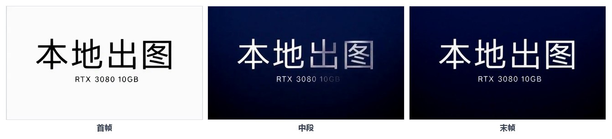

*图 5-2　608×352 / 124 帧首测：白底黑字平滑过渡到深底白字，三帧布局稳定*

**B. 480×864 / 124 帧（横版输入，验证分辨率上限）**

| 种子 | 耗时 | 采样速度 | 峰值显存 | 文件大小 |
|---|---|---|---|---|
| 42 | 115.17 s | 3.71 s/it | 9,735 MiB | 454,944 B |
| 43 | 108.36 s | 3.75 s/it | 9,731 MiB | 1,263,595 B |
| 44 | 108.43 s | 3.76 s/it | 9,725 MiB | 595,104 B |

**C. 480×864 / 124 帧（竖版输入，Qwen 生成首尾帧）**

| 种子 | 耗时 | 峰值显存 | 文件大小 |
|---|---|---|---|
| 42 | 126.33 s | 9,052 MiB | 422,383 B |
| 43 | 103.93 s | 9,564 MiB | 574,661 B |
| 44 | 103.30 s | 9,628 MiB | 432,163 B |

**D. 608×352 / 158 帧（长时长档）**

| 种子 | 耗时 | 采样速度 | 峰值显存 | 文件大小 |
|---|---|---|---|---|
| 42 | 73.31 s | 2.23 s/it | 9,430 MiB | 357,198 B |
| 43 | 66.39 s | 2.23 s/it | 9,603 MiB | 288,484 B |
| 44 | 66.27 s | 2.24 s/it | 9,577 MiB | 346,713 B |

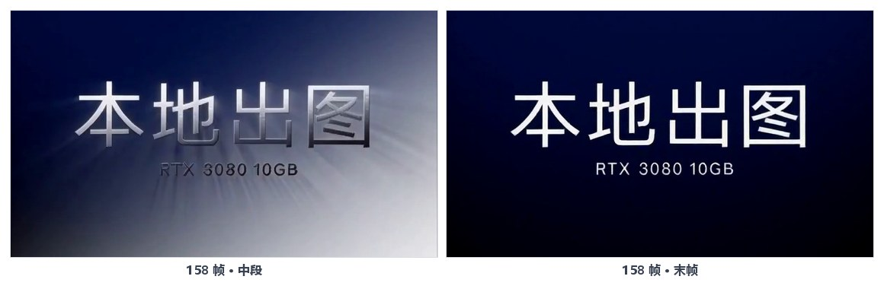

*图 5-3　608×352 / 158 帧：时长增加 27%，耗时只多 13–18 s，显存峰值持平*

所有 12 条均成功：可播放、无 OOM、无共享内存溢出、无性能恶化。日志均为 `0 models unloaded`，模型保持驻留。

### 5.4 规律与 10GB 上限

- **像素量决定耗时**：480×864 像素约为 608×352 的 1.94 倍，耗时约 2.2 倍（3.7 s/it vs 1.6 s/it）。
- **加时长很便宜**：608×352 从 124 帧加到 158 帧（+27% 时长），只多 13–18 s，显存峰值持平。
- **显存贴顶**：480×864（横版输入）峰值 9,725–9,735 MiB，距 10,240 MiB 上限只剩约 0.5 GB；这是 10GB 卡的可用上限区。
- **不要再并行**：跑 H3 时不要同时开另一个 ComfyUI、游戏或其他 GPU 任务。
- 想继续加帧，帧数保持 17k+5 网格（124、158 已实测；按网格下一档是 175、192），先单条测试再连跑。官方训练区间约 124–362 帧，超出属未验证区。

### 5.5 首尾帧制作（竖屏正确姿势）

横图喂竖幅画布会出现输入适配裁剪（首帧缩放、尾帧按比例居中裁剪），导致竖屏两侧文字被裁。正确流程：

1. Qwen-Image 2.1 文生图 768×1344，seed 2026 → 白底黑字竖版海报。
2. image_edit 改成深蓝黑渐变 + 白字。
3. 居中裁剪 746×1344，再缩放到 480×864。
4. 存为 `ComfyUI\input\h3_480x864_first.png` / `h3_480x864_last.png`。
5. H3 参数不变，仅改分辨率与输入图。

结果：构图正确、竖版文字完整、尾帧与目标图一致。

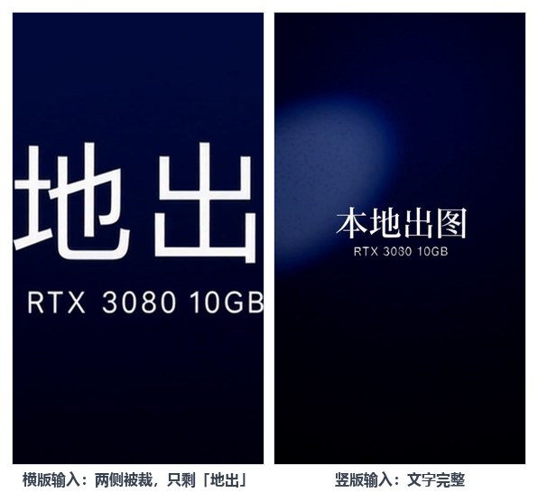

*图 5-4　左：横版首尾帧喂 480×864 画布，两侧被裁只剩“地出”；右：Qwen 竖版首尾帧，文字完整*

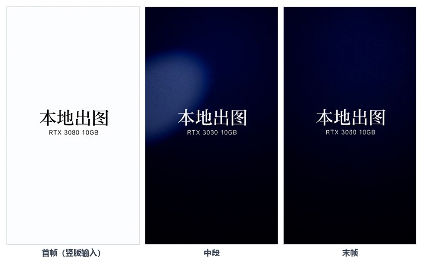

*图 5-5　竖版输入成片效果：构图正确、文字完整、尾帧与目标图一致*

### 5.6 质量与种子差异

- 同提示词下不同种子画面差异明显，属正常随机性。
- 竖屏种子 43 在第 70–90 帧出现密集白色噪斑（类似粒子风暴），第 110 帧后恢复干净；种子 42/44 无此现象。
- 这属于种子 / 去噪轨迹差异，Spectrum 会放大此类差异。**正式出片前必须预览中段帧**，遇到噪斑换种子重跑即可。
- 首尾帧只锚定开头和结尾，中间过渡由模型补全；提示词里写清“平滑过渡、无镜头抖动、布局保持不动”。

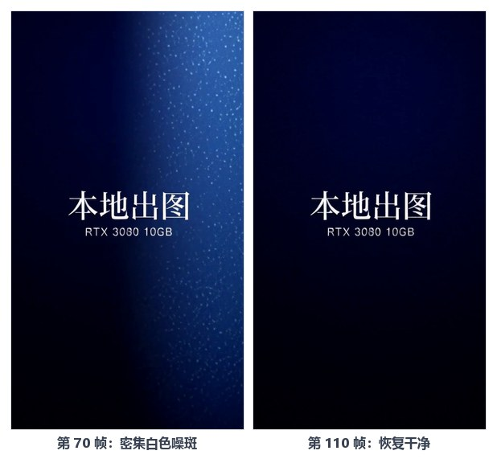

*图 5-6　竖屏 seed 43：第 70 帧出现密集白色噪斑，第 110 帧恢复干净；正式出片前必须预览中段帧*

### 5.7 验收方法（不要只看文件存在）

1. 用 PyAV 解码 mp4 的全部帧，至少检查首帧、中段、尾帧三张图。
2. 确认无全黑、无噪点、无撕裂、无花屏。
3. 确认分辨率、帧数、fps、时长与参数一致。
4. 连跑 3 条，记录耗时与峰值显存，确认无 OOM、无性能恶化。
5. 显存采样日志：`D:\LocalAI\work\h3-vram*.log`。

---

## 6. 提示词与参数速查

### 6.1 Qwen-Image

- 中文海报：主体 + 文字内容 + 版式 + 质感，一句话写全；文字用引号明确。
- 改图：先写“改什么”，再写“保留什么”，最后写“整体仍是什么”。
- 负向留空；提示词增强关闭（未下载 PE 模型时）。
- 25 步、CFG 1、euler/simple 是稳定起点。

### 6.2 Krea2

- 四段式固定人物模板：前两段锁人，后两段换场景。
- Turbo：8 步、CFG 1、euler/simple、ConditioningZeroOut。
- LoRA 0.8 起步；对比时种子固定，只改一个变量。
- 832×1216 竖幅是默认；换比例用 `ResolutionSelector`。

### 6.3 H3

- 提示词写“镜头是否固定、背景如何变化、文字如何变化、节奏是否平滑”。
- 不要写“快速运镜 / 大幅动作”，首尾帧约束下容易撕裂。
- 中段异常先换种子，再考虑调低分辨率或关 Spectrum。

### 6.4 通用实验方法

1. 一次只改一个变量（分辨率、帧数、种子、LoRA 权重四选一）。
2. 每个配置连跑 3 条，确认稳定再定档。
3. 记录耗时、峰值显存、输出文件大小、画面问题。
4. 结果写回记录文件，不凭记忆。

---

## 7. 排障手册（都是实际撞过的墙）

| 现象 | 根因 | 处理 |
|---|---|---|
| 工作流打开后节点一片空白（有端口、无标题、无参数） | 前端 1.57.4 不认手写的序列化 JSON；或后端掉线后页面缓存失效 | 先刷新页面；仍空白就改用官方模板改造的工作流；再不行完全退出 Desktop（含托盘）重开 |
| 模型下拉框里找不到新下载的文件 | ComfyUI 只在启动时扫描目录 | 确认 `extra_model_paths.yaml` 路径正确 → 清空队列 → 重启后端 → 刷新页面 |
| 明明下了模型却看不到，列表里是另一批模型 | 8188 上跑的不是你以为的那个后端（便携版 vs Desktop） | 查进程命令行，确认后端是 `D:\LocalAI\ComfyUI_windows_portable` |
| HuggingFace 直连超时 | 网络封锁 | 全部走 `hf-mirror.com`；gated 仓库改用 `Comfy-Org/Krea-2` |
| Comfy Desktop 提示「没有可安装的兼容构建」 | `desktop.comfy.org` / `repo.comfy.org` / `launch.comfy.org` 直连超时，构建列表拉不到 | 开系统级代理后重启 Desktop；或直接用「远程连接」连便携版 8188，不装 Desktop 后端 |
| Desktop 首次启动静默退出 | 首次启动 / 构建列表失败的表现，不一定是程序损坏 | 重开；确认进程与日志；核心出图不依赖它 |
| 队列显示「正在执行 2:53:10」但历史没有新图 | 僵尸队列显示 | 清空队列；历史记录不增长就是没真跑 |
| 官方示例右侧提示缺少 `krea2_darkbrush` | 官方示例自带风格 LoRA 未下载 | 无视；不要点内置下载（HF 直连会卡死） |
| CUDA out of memory | 分辨率 / 帧数超了 10GB 上限，或同时开了两个后端 | 降分辨率或帧数；启动加 `--lowvram`；确保只开一个实例 |
| CLIP 类型 / VAE 选错导致全图崩 | Krea2 与 H3 都用 `krea2` 类型但编码器不同；图片 VAE 与视频 VAE 不能混 | Krea2 图片：`qwen_image_vae`；H3 视频：`minimax_h3_video_vae`；按工作流原配 |
| 脚本提交任务被误判为失败（API 开发） | `node_errors: {}` 空对象在 JS 里是真值 | 判断改为 `Object.keys(node_errors ?? {}).length` |
| 480×864 竖屏视频两侧文字被裁 | 横版首尾帧喂竖幅画布，输入适配裁剪 | 先用 Qwen 生成 768×1344 竖版首尾帧，再裁到 480×864 |
| 长图整页截图重复平铺首屏 | 内置浏览器 fullPage 截图实现有 bug（不滚动） | 分段滚动截图（每段 1400px）→ Node 侧按行拼接 PNG |

---

## 8. 许可、成本与边界

### 8.1 许可

| 模型 | 许可 | 商用注意 |
|---|---|---|
| Qwen-Image 2.1 | Qwen Research License（仅非商业） | 商用改走 20B Apache-2.0 路线 |
| Krea2 Turbo / Base | Krea 2 community license | 发布页称个人与小团队可商用，交付前以官方 license 为准 |
| MiniMax H3 | 官方模型许可 + 社区量化权重 | 量化权重来自 Kijai 等社区作者，商用前核对原模型与量化作者条款 |
| LoRA / 墨玉 AIO | 社区作者条款 | 逐个核对，尤其是人像 LoRA 与二次分发 |

### 8.2 成本

- 软件与权重全部免费；成本是电费、时间与硬盘。
- 模型合计约 77 GB（Qwen 16.1 + Krea2 17.3 + AIO 22.3 + H3 20.1 + LoRA 约 1），建议留 100 GB 以上空闲。
- 本地没有按张 / 按秒计费，适合大批量试错；但 10GB 卡的耗时是硬约束。

### 8.3 边界

- 10GB 显存能稳定跑 1024² 图片、608×352 与 480×864 视频；更高分辨率未实测，不要默认可行。
- H3 视频无音频输出（工作流未接音频轨），是无声短片。
- 本地模型不替代云端顶配：速度、分辨率、时长都有差距；优势是隐私、可控、无排队、无单次费用。
- 所有推理在本机完成，提示词与图片不出本机；Krea2 官方模板里的云端提示词增强要保持关闭。

---

## 9. 维护与下一步

### 9.1 日常维护

- 出图前确认 8188 只有一个后端；出图后及时清理 `output` 与 `output\video`。
- 备份三样东西：`user\default\workflows`、`extra_model_paths.yaml`、`D:\LocalAI\work` 下的 API JSON 与脚本。
- 升级 ComfyUI 前先备份工作流；升级后跑一条 Qwen、一条 Krea2、一条 H3 做冒烟测试。
- 自定义节点升级后若 H3 报错，优先核对 ClipProj / Spectrum 版本与节点名。

### 9.2 下一步可做

| 方向 | 动作 | 风险 |
|---|---|---|
| 更长视频 | 608×352 下试 175 / 192 帧（17k+5 网格） | 显存持平，但需逐档实测 |
| 竖屏更长 | 480×864 + 158 帧 | 显存已贴顶，可能 OOM，先单条 |
| 更高分辨率 | 先测 640×960 级别 | 10GB 余量不足，成功率低 |
| 2K 重绘 | H3 出 768P → Open-H3-Regenerate-2K（ComfyUI ≥0.30 内置节点，模型约 21 GB） | 需额外下载与显存，未实测 |
| 提示词库 | 把服装 / 姿势 / 场景存 JSON，脚本随机组合批量出图 | 无 |
| 风格扩充 | 下载 `Comfy-Org/Krea-2` 的 10 个官方风格 LoRA | 无 |
| 商用 | Qwen 换 20B Apache-2.0；Krea2 / H3 核对许可 | 许可与质量需重新验收 |

---

## 10. 任务复盘：一晚上做了什么

### 10.1 时间线

| 时间 | 阶段 | 结果 |
|---|---|---|
| 10-29 17:06 | 接管项目，建立交接文档与验收标准 | 确认两条线：图像 / 视频 |
| 10-29 18:05 | NVIDIA 驱动 560.94 → 621.01 | CUDA 13.5，满足 H3 要求 |
| 10-29 20:55 | 魔搭下载 ComfyUI 便携版，升级到 0.43.0 | 服务、UI、节点验证通过 |
| 10-29 21:25–21:50 | 下载 Qwen-Image 2.1 三件套（16.10 GiB） | 3/3 校验通过，1024² 首测成功 |
| 10-29 22:10–22:16 | image_edit 背景替换、文字变白 | 27.1 s / 25.2 s，均符合指令 |
| 10-29 22:13–22:45 | 下载 H3 四个权重（20.11 GiB） | 魔搭 2 个 + hf-mirror 2 个，SHA-256 4/4 一致 |
| 10-29 23:00 | 安装 ClipProj、Spectrum 插件 | 节点验证通过，后端重启成功 |
| 10-29 23:08–23:17 | H3 608×352/124 帧首测 + 三条连跑 | 3/3 成功，48–55 s，峰值 ≤9,622 MiB |
| 10-29 23:28–23:34 | H3 480×864 三条连跑（横版输入） | 3/3 成功，103–115 s，峰值 9,735 MiB |
| 10-29 23:41–23:47 | Qwen 竖版首尾帧 + H3 竖屏三条连跑 | 3/3 成功，构图与文字完整 |
| 10-29 23:47–23:51 | H3 608×352/158 帧三条连跑 | 3/3 成功，66–73 s，显存持平 |
| 10-30 凌晨 | 复现 Krea2 固定人设工作流 | 三件套 17.3 GB、LoRA 对比、工作流入库、AIO 上线 |
| 10-30 | 沉淀文档 | HTML 手册、微信长图、本实操手册与推文 |

### 10.2 最终状态

| 线 | 状态 | 关键结论 |
|---|---|---|
| 环境 | 稳定 | 便携版 0.43.0 + 双模型目录 + 一键启动器 |
| 图像（Qwen） | 验收通过 | 1024² 文生图、参考图编辑、竖版 768×1344 均可用 |
| 图像（Krea2） | 验收通过 | 832×1216、8 步、LoRA 0.8，固定人设工作流可用 |
| 视频（H3） | 验收通过 | 608×352（124/158 帧）、480×864（横/竖输入）共 12 条连跑无 OOM |
| 未验证 | 待测试 | 175/192 帧、更高分辨率、2K 重绘、并行任务 |
| 已撤销 | — | 敏感数据分析线不做，项目范围收缩为图像 / 视频生成 |

### 10.3 三条最重要的经验

1. **参数照官方模板，工作流也从官方模板改。** 手写序列化 JSON 省不了多少时间，却会带来难排查的空白节点问题。
2. **一次只改一个变量，每个配置连跑三条。** 单条成功不代表稳定；三条连跑才能看出显存、速度是否恶化。
3. **视频一定要看中段。** 首尾帧正确不代表全片正确；种子差异和 Spectrum 都可能在中段制造噪斑。

---

## 附录 A：复现文件地图

**API 工作流（`D:\LocalAI\work\`）**

- Qwen：`qwen21-first-test-prompt.json`、`qwen21-run-12346.json`、`qwen21-run-12347.json`、`qwen21-edit-first-test.json`、`qwen21-edit-white-test.json`、`qwen21-portrait-white.json`、`qwen21-portrait-dark.json`
- H3：`minimax-h3-first-test.json`、`minimax-h3-seed43.json`、`minimax-h3-seed44.json`、`minimax-h3-480x864-seed42/43/44.json`、`minimax-h3-480x864-portrait-seed42/43/44.json`、`minimax-h3-608x352-158f-seed42/43/44.json`

**UI 工作流（`...\ComfyUI\user\default\workflows\`）**

- `Krea2·官方示例.json`
- `Krea2·固定人设·官方版.json`
- `MiniMax-H3·8G低显存·首尾帧.json`

**输出**

- 图片：`...\ComfyUI\output\Qwen21_*.png`、`krea2_*.png`
- 视频：`...\ComfyUI\output\video\MiniMax_H3_FL2V_*.mp4`

**日志**

- `D:\LocalAI\downloads\qwen-image-download.log`
- `D:\LocalAI\downloads\minimax-h3-modelscope.log`
- `D:\LocalAI\downloads\minimax-h3-hfmirror.log`
- `D:\LocalAI\work\h3-vram*.log`

---

## 附录 B：SHA-256 校验记录

**Qwen-Image 2.1**

| 文件 | SHA-256 |
|---|---|
| `qwen_image_2.1_int8_convrot.safetensors` | `cb74113cb03faecd79611b01fd7fd642f0aa60d6f0b95086abee214d75eaa57d` |
| `qwen3vl_8b_int8_convrot.safetensors` | `8bfd0f6e12abf2d2d697ecc888e5e90b0d6741d6708f05799f53afa560452e8f` |
| `qwen_image_2.1_vae_bf16.safetensors` | `bb21f7473051e1ac368515dd3f2e15cd44d7a11748ee8823e1ddca3e4876b7c9` |

**MiniMax H3**

| 文件 | SHA-256 |
|---|---|
| `minimax_h3_fl2va_pruned_w4a8_mixed.safetensors` | `01aa7b92c007c599890461c325f9b7e3c96fb06c36f242f95b62f7f20e538dec` |
| `qwen3vl_4b_int8_convrot.safetensors` | `ebbb3efdf4a6e1b766e32f6dc4fa92af9530edede0968c070b3e604aeca413aa` |
| `mmh3-4b-ClipProj-v3-mlp.safetensors` | `feef06ef3b9aede3b1f3331b71eebbc873e21a867d73bcf40ea2c0b007270693` |
| `minimax_h3_video_vae_int8_convrot.safetensors` | `9bb2d96f218c76babd85e0611b85ca8fb330a90546c01a0005e8a58a59593410` |

Krea2 三件套只做了大小逐字节核对与 safetensors 文件头检查，未记录官方 SHA-256；重新下载后按“大小 + 文件头 + 能否加载”三步验收。

---

## 附录 C：手册长图导出（可选）

把 HTML 手册转成微信可转发的长图时：

- 单文件版 HTML：图片全部转 base64 内嵌，发给对方浏览器即开。
- 长图 PNG：内置浏览器的 fullPage 截图有 bug（不滚动、重复平铺首屏），改用**分段滚动截图**（每段约 1400px）→ Node 侧解压 PNG、去滤波、按行拼接、重新压缩。
- 本机成品：`D:\桌面\Krea2出图手册-长图.png`（900×5531，4.8 MB）与 `Krea2出图手册-微信转发版.html`（3.2 MB 单文件）。

---

*本文依据 2026-10-29 ~ 2026-10-30 的两次实际会话与 `E:\mm3\HANDOFF.md` 整理；所有耗时与显存均为本机实测，换机器 / 换版本后需重新验收。*
