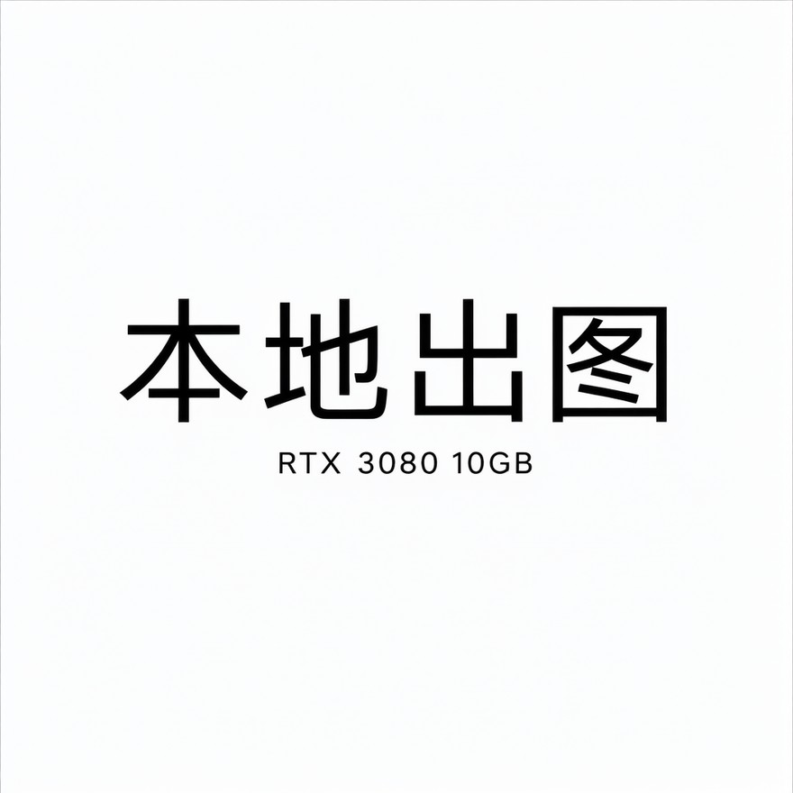
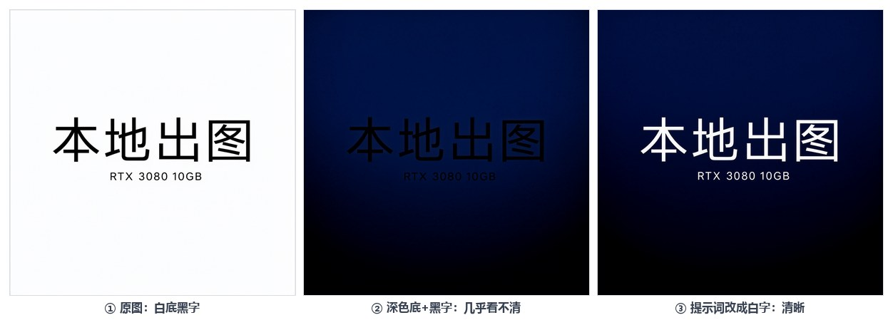
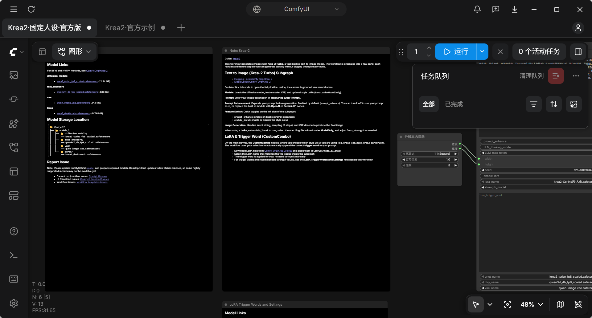
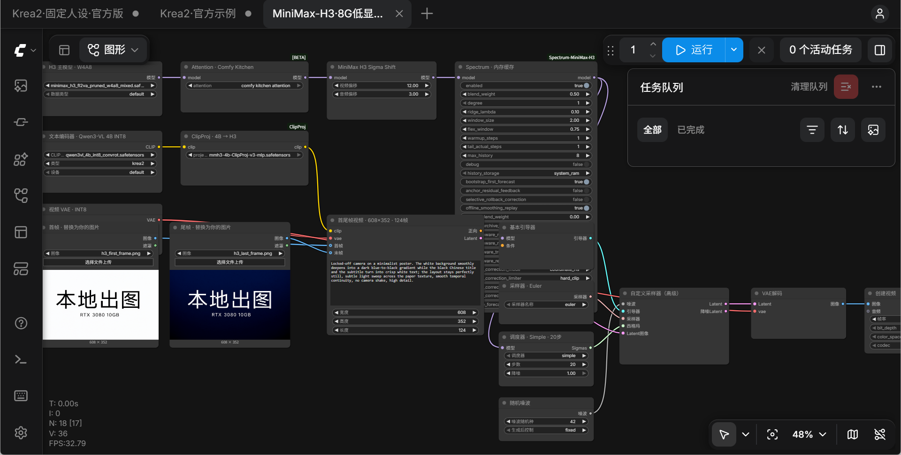
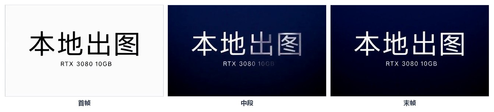

# 本地 AI 环境部署文档

**ComfyUI + Qwen-Image 2.1 + Krea2 Turbo + MiniMax H3**

> 适用对象：Windows 11 + NVIDIA 显卡（本文以 RTX 3080 10GB 为基准）的本地部署
> 文档版本：v1.0（2026-10-30）
> 参考机器：i7-13700KF / RTX 3080 10GB / 32GB RAM / Windows 11 22631 / NVIDIA 621.01
> 与《本地AI图像视频工作流-实操手册》的分工：**本文只讲部署、校验、升级与回滚**；提示词方法、玩法与实测数据见该手册。

---

## 0. 部署目标

部署完成后，本机应具备以下能力：

| 能力 | 验收标准 |
|---|---|
| ComfyUI 服务 | `http://127.0.0.1:8188` 可访问，`/system_stats` 返回 0.43.0 |
| Qwen-Image 2.1 | 1024×1024 文生图成功；参考图编辑成功；中文文字正确 |
| Krea2 Turbo | 832×1216、8 步、CFG 1 出图成功；LoRA 可加载 |
| MiniMax H3 | 608×352、124 帧、24fps 视频生成成功；三条连跑无 OOM |
| 模型目录 | D 盘便携版与 E 盘共享模型库同时可见 |
| 启动方式 | 双击桌面脚本即可拉起后端并打开桌面壳 |
| 可回滚 | 保留版本号、模型清单、工作流与配置备份 |

最终架构：

```text
Windows 11
├─ ComfyUI 便携版（D:\LocalAI\ComfyUI_windows_portable）
│   ├─ 端口 8188，Python 3.13.14 + PyTorch 2.13.0+cu130
│   ├─ custom_nodes：ComfyUI-ClipProj、ComfyUI-Spectrum-MiniMax-H3
│   ├─ models（D 盘）：Qwen-Image 2.1、MiniMax H3
│   └─ extra_model_paths.yaml → E 盘共享模型库
├─ 共享模型库（E:\Comfy-Desktop\ComfyUI-Shared\models）
│   ├─ Krea2 三件套
│   ├─ 3 个人像 / 风格 LoRA
│   └─ 墨玉 AIO 单文件（可选）
└─ 界面
    ├─ 浏览器：http://127.0.0.1:8188
    └─ Comfy Desktop → 远程连接 → 127.0.0.1:8188
```

---

## 1. 前置检查

### 1.1 硬件与系统

| 项目 | 最低要求 | 本文基准 | 检查命令 |
|---|---|---|---|
| GPU | NVIDIA，8GB 显存可试 | RTX 3080 10GB | `nvidia-smi --query-gpu=name,memory.total,driver_version --format=csv` |
| 内存 | 16GB | 32GB | `powershell -NoProfile -Command "(Get-CimInstance Win32_ComputerSystem).TotalPhysicalMemory/1GB"` |
| 系统 | Windows 10/11 x64 | Windows 11 22631 | `winver` |
| 驱动 | H3 要求 ≥580 | 621.01（CUDA 13.5） | `nvidia-smi` |
| 磁盘 | 100GB 空闲 | D 盘 + E 盘 | `Get-PSDrive D,E` |

磁盘规划建议：

- **程序盘（D）**：ComfyUI、Python 运行时、D 盘模型，约 45GB。
- **模型盘（E）**：Krea2 三件套 + LoRA + AIO，约 42GB。
- **下载缓存**：至少再留 10GB，用于临时压缩包与失败重下。
- 总预留：**100GB 以上**；如果想保留原始压缩包，预留 120GB。

### 1.2 软件工具

| 工具 | 用途 | 检查 |
|---|---|---|
| PowerShell 5.1 | 执行下载脚本 | `powershell -NoProfile -Command "$PSVersionTable.PSVersion"` |
| 7-Zip 或 WinRAR | 解压 ComfyUI 便携包（.7z） | 开始菜单搜索 7-Zip |
| Git | 拉取插件与升级 ComfyUI | `git --version` |
| Node.js（可选） | 运行 Krea2 命令行出图脚本 | `node --version`（建议 ≥22） |
| curl.exe | 下载与健康检查 | `curl.exe --version` |
| 浏览器 | 打开 ComfyUI | Edge / Chrome |

### 1.3 网络可达性

部署过程依赖三个下载渠道，先逐个测试：

```powershell
curl.exe -I --max-time 10 https://www.modelscope.cn
curl.exe -I --max-time 10 https://hf-mirror.com
curl.exe -I --max-time 10 https://gh-proxy.com
```

| 渠道 | 用途 | 本机实测 |
|---|---|---|
| ModelScope（魔搭） | ComfyUI 便携包、Qwen 三件套、H3 两个大文件 | 18–26 MB/s，首选 |
| hf-mirror.com | Krea2 三件套、H3 另两个文件 | 5–17 MB/s |
| gh-proxy.com | ComfyUI 升级、H3 插件 | 可用 |
| HuggingFace 直连 | 不可用 | 超时，不要依赖 |
| Comfy Desktop 构建服务 | 不可用 | `desktop.comfy.org` 等域名超时，不影响便携版部署 |

### 1.4 部署前必须确认的事

- [ ] 8188 端口没有其他 ComfyUI 实例在跑。
- [ ] 目标目录路径不含过长的中文 / 空格（本文路径已避开）。
- [ ] 显卡驱动满足 H3 要求（≥580）；不满足先升级并重启。
- [ ] 已确认模型许可证：Qwen-Image 2.1 仅非商业；Krea2 / H3 商用前核对原模型条款。
- [ ] 没有把 8188 暴露到公网的计划（ComfyUI 默认无鉴权）。

---

## 2. 部署流程总览

| 步骤 | 动作 | 预计耗时 | 验收点 |
|---|---|---|---|
| 1 | 驱动与系统准备 | 15–30 分钟（含重启） | `nvidia-smi` 正常，CUDA 版本满足 |
| 2 | 获取并启动 ComfyUI 便携版 | 10–20 分钟 | `/system_stats` 返回版本号 |
| 3 | 升级到 v0.43.0 | 10–20 分钟 | 版本号 0.43.0，节点数约 1,018 |
| 4 | 规划模型目录并合并 E 盘 | 5 分钟 | 两个目录的模型都可见 |
| 5 | 部署 Qwen-Image 2.1 | 20–30 分钟 | 三件套可见，1024² 首测成功 |
| 6 | 部署 Krea2 Turbo | 20–30 分钟 | 三件套可见，832×1216 出图成功 |
| 7 | 部署 MiniMax H3 + 插件 | 40–60 分钟 | 四个权重 + 两个节点可见，首测成功 |
| 8 | 配置启动器与桌面壳 | 10 分钟 | 双击脚本可拉起后端 |
| 9 | 完整验收 | 30–60 分钟 | 三项能力全部通过 |

**总耗时预估：3–5 小时**，主要取决于下载速度。建议按顺序执行，每步通过后再进入下一步。

---

## 3. 步骤 1：驱动与系统准备

### 3.1 检查当前驱动

```powershell
nvidia-smi
```

需要确认：

- `Driver Version` ≥ 580（H3 要求）；本文基准为 621.01。
- `CUDA Version` 显示 13.x（驱动自带运行时，不要求单独安装 CUDA Toolkit）。
- GPU 名称与显存容量正确。

### 3.2 升级驱动（仅当不满足要求）

1. 到 NVIDIA 官网下载对应显卡的 Game Ready / Studio 驱动。
2. 选择「自定义安装」→ 勾选「执行清洁安装」。
3. 安装完成后重启。
4. 重启后再跑一次 `nvidia-smi`，确认版本与 CUDA 版本。

注意：升级驱动前关闭正在跑图的 ComfyUI；升级后第一次启动模型加载会稍慢，属正常。

### 3.3 关闭冲突项

- 退出其他占用显存的程序（游戏、录屏、其他 AI 工具）。
- 确认任务管理器里没有残留的 `python.exe` 在跑 ComfyUI。
- 如果装了多个 ComfyUI（便携版 + 桌面版），部署期间只保留便携版。

---

## 4. 步骤 2：获取并启动 ComfyUI 便携版

### 4.1 下载

来源：魔搭数据集 `taoluban/comfyui-portable`。

| 项目 | 值 |
|---|---|
| 文件 | `ComfyUI_windows_portable_nvidia_modelscope.7z` |
| 大小 | 2,133,107,036 字节 |
| SHA-256 | `4a221588979b96b8244e0e50b2edca03af732acae1deba69d60aa3b4d60b9dba` |

下载后先校验哈希：

```powershell
Get-FileHash "D:\LocalAI\downloads\ComfyUI_windows_portable_nvidia_modelscope.7z" -Algorithm SHA256
```

哈希不一致就重新下载，不要解压后继续。

### 4.2 解压

用 7-Zip 解压到 `D:\LocalAI\`，得到：

```text
D:\LocalAI\ComfyUI_windows_portable\
├─ ComfyUI\
├─ python_embeded\
├─ run_nvidia_gpu.bat
└─ ...
```

确认 `python_embeded\python.exe` 存在。如果解压后多套了一层目录，把内层内容移到 `D:\LocalAI\ComfyUI_windows_portable\` 下。

### 4.3 首次启动

```powershell
cd D:\LocalAI\ComfyUI_windows_portable
.\python_embeded\python.exe -s ComfyUI\main.py --windows-standalone-build
```

或者双击 `run_nvidia_gpu.bat`。看到 `To see the GUI go to: http://127.0.0.1:8188` 即启动成功。

### 4.4 健康检查

另开一个 PowerShell：

```powershell
curl.exe -s http://127.0.0.1:8188/system_stats
```

应返回 JSON，包含 `comfyui_version`。浏览器打开 `http://127.0.0.1:8188`，界面能正常加载即通过。

### 4.5 记录基线版本

```powershell
(Invoke-RestMethod http://127.0.0.1:8188/system_stats).system.comfyui_version
(Invoke-RestMethod http://127.0.0.1:8188/object_info).PSObject.Properties.Count
```

记录当前版本与节点数，作为升级前的对照。

---

## 5. 步骤 3：升级到 v0.43.0

便携包内置的是旧版（0.33.1），需要升级到 v0.43.0，才能使用 Qwen 2.1 与 H3 的原生节点。

### 5.1 停止后端

关闭运行 ComfyUI 的窗口，或结束对应的 Python 进程。确认 8188 已释放：

```powershell
curl.exe -s --max-time 3 http://127.0.0.1:8188/system_stats
```

无响应即已停止。

### 5.2 通过 gh-proxy 拉取指定版本

```powershell
cd D:\LocalAI\ComfyUI_windows_portable\ComfyUI
git status --short
git remote -v
git fetch https://gh-proxy.com/https://github.com/comfyanonymous/ComfyUI.git tag v0.43.0
git checkout v0.43.0
git log -1 --oneline
```

`git status` 必须干净；有本地改动先备份，不要直接覆盖。

目标 commit：`426f5eea52a7ece1dd599fff4cb6cd1f352ddd24`。

如果当前目录不是 Git 仓库，先确认解压包是否自带 `.git`；没有的话，改用官方 v0.43.0 便携包替换，不要在非 Git 目录里强行覆盖。

### 5.3 升级依赖

```powershell
cd D:\LocalAI\ComfyUI_windows_portable
.\python_embeded\python.exe -m pip install --upgrade -r ComfyUI\requirements.txt -i https://mirrors.cloud.tencent.com/pypi/simple
```

本机实测升级后的关键版本：

| 包 | 版本 |
|---|---|
| frontend | 1.57.4 |
| templates | 0.11.97 |
| embedded-docs | 0.5.15 |
| comfy-kitchen | 0.2.40 |
| comfy-aimdo | 0.6.0 |

### 5.4 重启并验证

```powershell
.\python_embeded\python.exe -s ComfyUI\main.py --windows-standalone-build
```

```powershell
curl.exe -s http://127.0.0.1:8188/system_stats
curl.exe -s http://127.0.0.1:8188/object_info/UNETLoader
```

验收：

- `/system_stats` 返回 `0.43.0`。
- `/object_info` 节点数约 1,018。
- 能搜到 `TextEncodeQwenImage21`、`EmptyMiniMaxH3LatentAV`、`MiniMaxH3ImageToVideo`。
- 浏览器中文界面正常。

> 版本固定建议：v0.43.0 是本文验证过的组合。不要在生产环境直接追最新版；升级前先备份工作流，升级后跑一轮冒烟测试。

---

## 6. 步骤 4：模型目录规划

### 6.1 目录结构

```text
D:\LocalAI\ComfyUI_windows_portable\ComfyUI\models\
├─ diffusion_models\      # 主模型
├─ text_encoders\         # 文本编码器
├─ vae\                   # VAE
├─ clip_projections\      # H3 ClipProj 矩阵（插件首次启动会创建）
├─ checkpoints\           # 墨玉 AIO（可选）
└─ loras\                 # Krea2 LoRA

E:\Comfy-Desktop\ComfyUI-Shared\models\
├─ diffusion_models\krea2_turbo_fp8_scaled.safetensors
├─ text_encoders\qwen3vl_4b_fp8_scaled.safetensors
├─ vae\qwen_image_vae.safetensors
├─ loras\krea2-*.safetensors
└─ checkpoints\Krea2-turbo-Ink_Jade-AIO-V1-fp8.safetensors（可选）
```

### 6.2 写入合并配置

文件：`D:\LocalAI\ComfyUI_windows_portable\ComfyUI\extra_model_paths.yaml`

```yaml
krea2_shared:
    base_path: E:/Comfy-Desktop/ComfyUI-Shared/models/
    checkpoints: checkpoints
    diffusion_models: diffusion_models
    text_encoders: text_encoders
    vae: vae
    loras: loras
    upscale_models: upscale_models
```

注意：

- 路径用正斜杠，末尾带 `/`。
- 缩进用 4 个空格，不要用 Tab。
- 这是**追加**配置，不会覆盖便携版自带的 D 盘模型目录。

### 6.3 重启并验证

重启后端后：

```powershell
curl.exe -s http://127.0.0.1:8188/object_info/UNETLoader
curl.exe -s http://127.0.0.1:8188/object_info/CLIPLoader
curl.exe -s http://127.0.0.1:8188/object_info/VAELoader
```

确认 D 盘与 E 盘的模型文件名同时出现。如果 E 盘模型不可见，依次检查：

1. yaml 路径是否写对；
2. 后端是否真的重启了；
3. 8188 上跑的是不是你以为的那个后端（看进程命令行）；
4. 文件名是否与节点枚举完全一致（大小写、空格）。

---

## 7. 步骤 5：部署 Qwen-Image 2.1

### 7.1 下载

使用部署包脚本（ModelScope 主源，只下载、不安装）：

```powershell
powershell -NoProfile -ExecutionPolicy Bypass -File E:\mm3\deploy\qwen-image\download-qwen-image.ps1 `
  -Bundle recommended -TargetRoot "D:\LocalAI\ComfyUI_windows_portable\ComfyUI"
```

如果部署包不在 `E:\mm3`，把脚本路径换成实际位置。脚本支持 `-DryRun`，可先空跑确认目标路径。

### 7.2 文件清单

| 文件 | 字节 | 目录 |
|---|---|---|
| `qwen_image_2.1_int8_convrot.safetensors` | 7,256,783,064 | `models\diffusion_models\` |
| `qwen3vl_8b_int8_convrot.safetensors` | 9,350,798,360 | `models\text_encoders\` |
| `qwen_image_2.1_vae_bf16.safetensors` | 675,509,688 | `models\vae\` |

合计 17,283,091,112 字节（16.10 GiB）。SHA-256 见附录 B。

### 7.3 识别检查

```powershell
curl.exe -s http://127.0.0.1:8188/object_info/UNETLoader
curl.exe -s http://127.0.0.1:8188/object_info/CLIPLoader
curl.exe -s http://127.0.0.1:8188/object_info/VAELoader
```

验收：

- `UNETLoader` 列出 `qwen_image_2.1_int8_convrot.safetensors`。
- `CLIPLoader` 列出 `qwen3vl_8b_int8_convrot.safetensors`，且 type 含 `qwen_image`。
- `VAELoader` 列出 `qwen_image_2.1_vae_bf16.safetensors`。

### 7.4 首测

用官方模板 `image_qwen_image_2_1_t2i` 构造 API 工作流，参数：

- 1024×1024；
- 25 步、CFG 1.0、euler / simple、denoise 1.0；
- 负向留空；
- 提示词增强关闭。

首测提示词：

```text
一张极简海报，白色背景，中央黑色中文大字“本地出图”，下方小字“RTX 3080 10GB”，平面设计，高清，边缘干净
```

通过标准：

- 3 张图全部成功，单张 14–18 秒；
- 峰值显存约 9.5GB，无 OOM；
- 中文“本地出图”字形正确、无乱码。



*首测通过时应得到类似结果：1024×1024，中文“本地出图”无乱码*

参考工作流：`D:\LocalAI\work\qwen21-first-test-prompt.json`。

### 7.5 可选：参考图编辑

用模板 `image_qwen_image_2_1_image_edit`，单图输入走 `images.image_1`，latent 跟随参考图尺寸。首测 25–27 秒。参考工作流：`qwen21-edit-white-test.json`。



*验收参考：第二次指令要求“文字改成白色”后，深色底上的文字应清晰可读*

---

## 8. 步骤 6：部署 Krea2 Turbo

### 8.1 下载三件套

官方 `krea/Krea-2-Turbo` 是 gated 仓库，匿名下载不了；使用 ComfyUI 官方搬运仓库 `Comfy-Org/Krea-2`，走 hf-mirror：

```powershell
$base = "https://hf-mirror.com/Comfy-Org/Krea-2/resolve/main"
$dest = "E:\Comfy-Desktop\ComfyUI-Shared\models"
$files = @(
  "diffusion_models/krea2_turbo_fp8_scaled.safetensors",
  "text_encoders/qwen3vl_4b_fp8_scaled.safetensors",
  "vae/qwen_image_vae.safetensors"
)
foreach ($f in $files) {
  $out = Join-Path $dest ($f -replace '/', '\')
  New-Item -ItemType Directory -Force -Path (Split-Path $out) | Out-Null
  curl.exe -L --fail --retry 3 -C - -o $out "$base/$f"
}
```

### 8.2 文件清单

| 文件 | 字节 | 目录 |
|---|---|---|
| `krea2_turbo_fp8_scaled.safetensors` | 13,141,730,784 | `diffusion_models\` |
| `qwen3vl_4b_fp8_scaled.safetensors` | 5,242,467,968 | `text_encoders\` |
| `qwen_image_vae.safetensors` | 253,806,246 | `vae\` |

合计 18,638,004,998 字节（约 17.36 GiB）。

下载后校验：

```powershell
Get-ChildItem "E:\Comfy-Desktop\ComfyUI-Shared\models" -Recurse -Filter *.safetensors |
  Select-Object FullName, Length
```

文件大小必须与上表逐字节一致；再用文件头检查确认不是网页内容：

```powershell
$f = "E:\Comfy-Desktop\ComfyUI-Shared\models\diffusion_models\krea2_turbo_fp8_scaled.safetensors"
$fs = [System.IO.File]::OpenRead($f)
$buf = New-Object byte[] 8
$fs.Read($buf, 0, 8) | Out-Null
$fs.Close()
[System.BitConverter]::ToUInt64($buf, 0)
```

返回值应是合理的元数据长度（远小于文件大小），不是 0 或异常大数。

### 8.3 可选：LoRA 与墨玉 AIO

| 资产 | 放置目录 | 作用 |
|---|---|---|
| `krea2-Cc-Ins风-人像.safetensors` | `loras\` | 人像风格，0.8 起步 |
| `krea2-Cc风情万种-人像.safetensors` | `loras\` | 人像风格 |
| `krea2-Cc-MJ-风格滤镜.safetensors` | `loras\` | MJ 风格滤镜 |
| `Krea2-turbo-Ink_Jade-AIO-V1-fp8.safetensors` | `checkpoints\` | 单文件三合一底模 |

这些是可选社区资产，不影响三件套部署验收。LoRA 每个约 343MB；AIO 约 22.3GB，与三件套二选一即可出图。

### 8.4 识别检查

重启后端后：

```powershell
curl.exe -s http://127.0.0.1:8188/object_info/UNETLoader
curl.exe -s http://127.0.0.1:8188/object_info/CLIPLoader
curl.exe -s http://127.0.0.1:8188/object_info/VAELoader
curl.exe -s http://127.0.0.1:8188/object_info/LoraLoaderModelOnly
```

验收：

- UNET 列表出现 `krea2_turbo_fp8_scaled.safetensors`；
- CLIP 列表出现 `qwen3vl_4b_fp8_scaled.safetensors`，type 含 `krea2`；
- VAE 列表出现 `qwen_image_vae.safetensors`；
- LoRA 列表出现三个人像 / 风格文件。

### 8.5 首测

参数（来自官方模板 `image_krea2_turbo_t2i.json`）：

| 项目 | 值 |
|---|---|
| 主模型 | `krea2_turbo_fp8_scaled.safetensors` |
| CLIP | `qwen3vl_4b_fp8_scaled.safetensors`，type=`krea2` |
| VAE | `qwen_image_vae.safetensors` |
| 采样 | 8 步、CFG 1、euler / simple、denoise 1.0 |
| 负向 | `ConditioningZeroOut` |
| LoRA | `LoraLoaderModelOnly`，权重 0.8 |
| 画布 | 832×1216 |

命令方式（部署包自带脚本）：

```powershell
node E:\mm3\krea2-generate.mjs lora 42 krea2_deploy_smoke
```

通过标准：

- 首跑约 3 分钟（含 12GB 模型加载），之后约 81 秒一张；
- 输出在 `E:\mm3\krea2-out\krea2_deploy_smoke.png`；
- 832×1216，人物、服装、构图正常。


*验收参考：样本 A 同种子 42，左为无 LoRA 基线，右为 Ins 风 LoRA 0.8*

UI 方式：工作流库选「Krea2·固定人设·官方版」，点「运行」。如果工作流库还没有这个文件，用官方模板另存后按上表参数配置，或从备份的 `workflows` 目录复制；不要手写工作流 JSON。



*部署完成后 UI 应能打开该工作流：画布为主子图节点，右侧任务队列显示 0 个活动任务*

### 8.6 三条硬规则

1. CLIPLoader 类型必须 `krea2`，不是 `lumina2`。
2. VAE 必须 `qwen_image_vae`，不是 H3 视频 VAE。
3. CFG 必须 1，负向用 `ConditioningZeroOut`；不要接 AuraFlow 采样节点。

---

## 9. 步骤 7：部署 MiniMax H3

### 9.1 下载四个权重

```powershell
powershell -NoProfile -ExecutionPolicy Bypass -File E:\mm3\deploy\minimax-h3\download-minimax-h3.ps1 `
  -ModelsRoot "D:\LocalAI\ComfyUI_windows_portable\ComfyUI\models" -HfMirror -VerifyHash
```

脚本会优先走魔搭，缺失的文件走 hf-mirror，并在完成后校验 SHA-256。

| 文件 | 字节 | 目录 |
|---|---|---|
| `minimax_h3_fl2va_pruned_w4a8_mixed.safetensors` | 12,540,858,008 | `diffusion_models\` |
| `qwen3vl_4b_int8_convrot.safetensors` | 5,374,169,456 | `text_encoders\` |
| `mmh3-4b-ClipProj-v3-mlp.safetensors` | 503,434,368 | `clip_projections\` |
| `minimax_h3_video_vae_int8_convrot.safetensors` | 3,171,670,912 | `vae\` |

合计 21,590,132,744 字节（20.11 GiB）。

### 9.2 安装两个插件

```powershell
cd D:\LocalAI\ComfyUI_windows_portable\ComfyUI\custom_nodes
git clone --depth 1 https://gh-proxy.com/https://github.com/nicolab28/ComfyUI-ClipProj.git
git clone --depth 1 https://gh-proxy.com/https://github.com/xmarre/ComfyUI-Spectrum-MiniMax-H3.git
```

版本核对：

```powershell
Select-String -Path "ComfyUI-ClipProj\pyproject.toml" -Pattern '^version'
Select-String -Path "ComfyUI-Spectrum-MiniMax-H3\pyproject.toml" -Pattern '^version'
```

目标版本：ClipProj **0.1.13**、Spectrum **0.2.29**。

**版本陷阱**：ClipProj 仓库的 Git tag 只到 v0.1.4，但 `pyproject.toml` 里是 0.1.13。不要用 tag 判断版本；直接装 main 分支，装完看 `pyproject.toml`。低于 0.1.13 的版本加载 `-v3-mlp` 矩阵会抛 `KeyError: 'W'`。

两个插件的 `dependencies` 都为空，不需要额外 pip 安装。

### 9.3 重启并验证节点

重启后端后：

```powershell
curl.exe -s http://127.0.0.1:8188/object_info/ClipProjApply
curl.exe -s http://127.0.0.1:8188/object_info/SpectrumApplyMiniMaxH3
curl.exe -s http://127.0.0.1:8188/object_info/MiniMaxH3ImageToVideo
```

验收：

- `ClipProjApply` 存在，`projection` 选项含 `mmh3-4b-ClipProj-v3-mlp.safetensors`；
- `SpectrumApplyMiniMaxH3` 存在；
- `MiniMaxH3ImageToVideo` 存在；
- 启动日志中两个自定义节点导入无报错，出现 `[ClipProj] graph watch installed`。

### 9.4 首测

工作流链路：

```text
UNETLoader
  → ModelAttentionBackend(comfy kitchen attention)
  → MiniMaxH3SigmaShift(12.0 / 3.0)
  → SpectrumApplyMiniMaxH3
  → BasicGuider

CLIPLoader(type=krea2)
  → ClipProjApply(v3-mlp)
  → MiniMaxH3ImageToVideo

KSampler: euler + simple, 20 步, denoise 1.0
  → VAEDecode → CreateVideo(24fps) → SaveVideo
```

首测参数：608×352、124 帧、24fps、20 步、Shift 12/3、seed 42、Spectrum 开启、batch 1。



*部署完成后 UI 应能看到完整 H3 链路：首尾帧输入 → 主模型 → Attention → Sigma Shift → Spectrum → 采样器 → VAE 解码 → 视频封装*

如果首测异常，先旁路 Spectrum 跑基线，确认链路后再开启对比。

输入：任意 608×352 首尾帧（可先用 Qwen 生成海报，再裁剪到 608×352），放 `ComfyUI\input\`。

通过标准：

- 单条 48–55 秒完成；
- 峰值显存 ≤9.7GB，无 OOM；
- 输出 mp4 可播放，5.17 秒；
- 解码首 / 中 / 尾帧，画面正确、无全黑 / 噪点 / 撕裂。



*验收参考：608×352 / 124 帧首测的首帧、中段、末帧，布局稳定、无撕裂*

参考工作流：`D:\LocalAI\work\minimax-h3-first-test.json`。

### 9.5 三条连跑验收

首测通过后，用种子 42 / 43 / 44 连跑三条，**不重启、不清缓存**：

- 三条全部成功；
- 单条 48–55 秒，无性能恶化；
- 日志显示 `0 models unloaded`；
- 峰值显存 ≤9.7GB。

通过后再考虑 158 帧或 480×864；不要一上来就跑最高规格。

### 9.6 工作流文件准备

部署完成后，工作流库建议具备：

| 工作流 | 用途 |
|---|---|
| `Krea2·固定人设·官方版.json` | Krea2 日常出图（样本 A 提示词、LoRA 0.8、种子 42） |
| `MiniMax-H3·8G低显存·首尾帧.json` | H3 首尾帧视频 |

来源二选一：

1. 从备份的 `ComfyUI\user\default\workflows` 目录复制；
2. 在 UI 里打开官方模板，按第 8 / 9 节参数另存为新工作流。

硬规则：**不要手写工作流序列化 JSON**。这个前端版本不认手写格式，会出现「有端口、无标题、无参数」的空白节点；一律以官方模板为底改。

API 参考工作流在 `D:\LocalAI\work\`（Qwen / H3 的 `*.json`），可用 `POST /prompt` 直接提交，不依赖 UI。

---

## 10. 步骤 8：配置启动器与桌面壳

### 10.1 一键启动脚本

保存为 `D:\桌面\启动ComfyUI.bat`（UTF-8 编码）：

```bat
@echo off
chcp 65001 >nul
title ComfyUI Launcher

curl.exe -sf -o NUL --max-time 2 http://127.0.0.1:8188/system_stats
if %errorlevel%==0 goto backend_ok

echo [1/3] 启动后端(8188)... 已最小化到任务栏，关闭那个窗口=停止服务
start "ComfyUI Backend 8188 (close=stop)" /min cmd /k "cd /d D:\LocalAI\ComfyUI_windows_portable && python_embeded\python.exe -s ComfyUI\main.py --windows-standalone-build"

echo       等待后端就绪(最多2分钟)...
set /a n=0
:wait
curl.exe -sf -o NUL --max-time 2 http://127.0.0.1:8188/system_stats
if %errorlevel%==0 goto backend_ok
set /a n+=1
if %n% geq 60 (echo 后端启动超时，请查看后台窗口的报错 & pause & exit /b 1)
timeout /t 2 /nobreak >nul
goto wait

:backend_ok
echo [2/3] 后端已就绪: http://127.0.0.1:8188
echo [3/3] 打开 Comfy Desktop...
start "" "E:\application\Comfy Desktop\Comfy Desktop.exe"
exit /b 0
```

如果不用 Comfy Desktop，删掉最后一行 `start`，直接用浏览器打开 8188。

### 10.2 使用规则

- 双击脚本 → 后端最小化启动 → 等就绪 → 自动打开 Desktop。
- Desktop 里点「远程连接」→ `127.0.0.1:8188`。
- 关闭任务栏里标题带 **ComfyUI Backend 8188** 的窗口 = 停止服务。
- **一次只开一个后端**；端口被占说明已有实例，直接开浏览器用。
- 后端重启后刷新页面，否则节点定义和模型列表可能还是旧的。

---

## 11. 完整验收清单

逐项打勾，全部通过才算部署完成。

### A. 环境

- [ ] `nvidia-smi` 显示驱动 ≥580，GPU 显存正确。
- [ ] `/system_stats` 返回 `0.43.0`。
- [ ] `/object_info` 节点数 ≥1,018（装 H3 插件前 1,018，装完后本机为 1,029）。
- [ ] 浏览器能打开 8188，界面无报错。
- [ ] `extra_model_paths.yaml` 生效，D/E 两盘模型同时可见。

### B. 模型

- [ ] Qwen 三件套大小 / SHA-256 全部一致。
- [ ] H3 四个文件大小 / SHA-256 全部一致。
- [ ] Krea2 三件套大小一致，safetensors 文件头合法。
- [ ] ClipProj / Spectrum 节点可见。
- [ ] 三个 Krea2 LoRA 可见（可选）。

### C. 出图

- [ ] Qwen 1024² 文生图 3/3 成功，中文正确。
- [ ] Qwen 参考图编辑成功，文字保留 / 改色符合指令。
- [ ] Krea2 832×1216 出图成功，8 步 / CFG 1。
- [ ] Krea2 LoRA 可加载，同种子对比有可见差异。

### D. 出视频

- [ ] H3 608×352/124 帧首测成功，mp4 可播放。
- [ ] 三条连跑 3/3 成功，无 OOM、无性能恶化。
- [ ] 首 / 中 / 尾帧解码检查通过。
- [ ] 峰值显存记录在案（应 ≤9.7GB）。

### E. 可运维性

- [ ] 重启电脑后，双击脚本能恢复服务。
- [ ] 工作流库能打开 `Krea2·固定人设·官方版` 与 H3 工作流。
- [ ] 版本号、模型清单、SHA-256 已归档。
- [ ] 工作流与配置文件已备份。

---

## 12. 资源与耗时估算

### 12.1 下载量

| 项目 | 大小 |
|---|---|
| ComfyUI 便携包 | 2.13 GB |
| Qwen-Image 2.1 | 16.10 GiB |
| Krea2 三件套 | 17.36 GiB |
| Krea2 LoRA ×3（可选） | 约 1.0 GB |
| 墨玉 AIO（可选） | 22.3 GB |
| MiniMax H3 | 20.11 GiB |
| 插件 | < 50 MB |
| **合计（不含可选）** | **约 60 GB**（按 1 GiB ≈ 1.074 GB 折算） |
| **合计（含可选）** | **约 83 GB** |

### 12.2 磁盘占用

- 程序 + Python 运行时：约 5 GB。
- 模型：约 57–81 GB。
- 输入 / 输出 / 临时文件：建议预留 10 GB。
- **建议目标盘空闲：100 GB 以上。**

### 12.3 时间

| 阶段 | 时间 |
|---|---|
| 驱动升级 + 重启 | 15–30 分钟 |
| ComfyUI 下载 / 解压 / 启动 | 10–20 分钟 |
| 升级 v0.43.0 + 依赖 | 10–20 分钟 |
| Qwen 下载 + 首测 | 20–30 分钟 |
| Krea2 下载 + 首测 | 20–30 分钟 |
| H3 下载 + 插件 + 首测 | 40–60 分钟 |
| 连跑验收 | 30–60 分钟 |
| **合计** | **3–5 小时** |

网络是最大变量：hf-mirror 在 5 MB/s 时，H3 的两个文件就要十几分钟；魔搭通常更快。

---

## 13. 部署期故障排查

| 现象 | 可能原因 | 处理 |
|---|---|---|
| `python_embeded\python.exe` 找不到 | 解压多套了一层目录 / 解压不完整 | 把内层内容移到 `D:\LocalAI\ComfyUI_windows_portable\`；重新解压 |
| 启动即报缺少 DLL | VC++ 运行库缺失 / 解压损坏 | 安装 VC++ 2015–2022 x64；核对压缩包 SHA-256 |
| 8188 无响应 | 后端未启动 / 端口被占 / 启动报错 | 看控制台与 `comfyui.log`；用 `netstat -ano` 找到占用 8188 的 PID |
| 浏览器能开但节点全空 | 后端掉线后页面缓存失效 | 刷新（Ctrl+R）；仍空白则重启 Desktop |
| 新模型下拉框没有 | 后端只在启动时扫描 | 清空队列 → 重启后端 → 刷新页面 |
| 模型列表是另一批文件 | 8188 上跑的是另一个后端 | 查进程命令行，确认指向便携版目录 |
| Qwen 首测 OOM | 分辨率过高 / 并行任务 | 降到 1024²；关闭其他 GPU 程序；启动加 `--lowvram` |
| Krea2 出图全崩 | CLIP 类型或 VAE 选错 | CLIP 用 `krea2`，VAE 用 `qwen_image_vae` |
| Krea2 画面劣化 | CFG 设了 3 / 接了负向词 | CFG 1 + `ConditioningZeroOut` |
| H3 节点不存在 | ComfyUI 版本过低 / 插件未装 | 升级到 0.43.0；装两个插件并重启 |
| `ClipProjApply` 报 `KeyError: 'W'` | ClipProj < 0.1.13 | 升级到 main 分支的 0.1.13+ |
| H3 首测 OOM | 直接跑了 480×864 / 有并行任务 | 先跑 608×352/124 帧；关闭其他 GPU 程序 |
| H3 视频两侧被裁 | 横版首尾帧喂竖幅画布 | 用 768×1344 竖版首帧，裁到 480×864 |
| Comfy Desktop 提示「没有可安装的兼容构建」 | 构建服务域名超时 | 用浏览器或「远程连接」连 8188，不影响便携版 |
| 下载哈希不一致 | 文件损坏 / 跨源续传 | 删除后整文件重下，不要跨源续传 |
| `curl` 命令不存在 | 用了别名 / 旧系统 | 使用 `curl.exe`（Windows 11 自带） |
| PowerShell 脚本被策略拦截 | 执行策略限制 | 使用 `-ExecutionPolicy Bypass`（命令已带） |

---

## 14. 升级、回滚与卸载

### 14.1 升级前

- 备份 `ComfyUI\user\default\workflows`。
- 备份 `extra_model_paths.yaml`。
- 备份 `D:\LocalAI\work` 下的 API 工作流与脚本。
- 记录当前 ComfyUI 版本、插件版本、模型清单。

### 14.2 升级 ComfyUI

- 只升级到已验证的版本（本文为 v0.43.0）。
- 升级后跑三条冒烟测试：Qwen 1024²、Krea2 832×1216、H3 608×352/124。
- 如果插件报错，先看插件版本，再考虑回滚 ComfyUI。

### 14.3 回滚

```powershell
cd D:\LocalAI\ComfyUI_windows_portable\ComfyUI
git log --oneline -5
git checkout <上一个可用版本>
```

回滚后重新安装对应版本的依赖：

```powershell
cd D:\LocalAI\ComfyUI_windows_portable
.\python_embeded\python.exe -m pip install -r ComfyUI\requirements.txt
```

模型文件与工作流不需要动。

### 14.4 卸载

按需删除：

- 程序：`D:\LocalAI\ComfyUI_windows_portable`
- 共享模型：`E:\Comfy-Desktop\ComfyUI-Shared\models`
- 桌面脚本：`D:\桌面\启动ComfyUI.bat`
- 输出：`...\ComfyUI\output`（先确认没有要保留的图 / 视频）

卸载前先备份工作流、API JSON、输出成品与模型清单。

---

## 15. 安全与合规

### 15.1 服务暴露

- ComfyUI 默认监听 `127.0.0.1:8188`，**不要**改成 `0.0.0.0` 暴露到局域网或公网。
- 如果必须远程访问，使用 SSH 隧道 / VPN / 带鉴权的反向代理，并配置防火墙白名单。
- 不要在 8188 上直接存放敏感素材；ComfyUI 没有内置账号体系。

### 15.2 数据

- 所有推理在本机完成，提示词、参考图、输出视频默认不出本机。
- Krea2 官方模板里的「云端提示词增强」保持关闭。
- 不要点击工作流里来源不明的「自动下载」按钮；模型统一走本文列出的渠道。

### 15.3 许可

| 模型 | 许可 | 商用提示 |
|---|---|---|
| Qwen-Image 2.1 | Qwen Research License（仅非商业） | 商用改走 20B Apache-2.0 路线 |
| Krea2 Turbo / Base | Krea 2 community license | 交付前以官方 license 为准 |
| MiniMax H3 | 官方模型许可 + 社区量化 | 核对原模型与量化作者条款 |
| LoRA / 墨玉 AIO | 社区作者条款 | 逐个核对，尤其是人像 LoRA |

---

## 附录 A：版本矩阵

| 组件 | 版本 / Commit |
|---|---|
| Windows | 11 22631 |
| NVIDIA 驱动 | 621.01（CUDA 13.5） |
| ComfyUI | 0.43.0，commit `426f5eea52a7ece1dd599fff4cb6cd1f352ddd24` |
| Python | 3.13.14 |
| PyTorch | 2.13.0+cu130 |
| frontend | 1.57.4 |
| templates | 0.11.97 |
| ComfyUI-ClipProj | 0.1.13 |
| ComfyUI-Spectrum-MiniMax-H3 | 0.2.29 |
| Qwen-Image 2.1 | int8_convrot 三件套 |
| Krea2 | Turbo FP8 三件套 |
| MiniMax H3 | FL2VA W4A8 + Qwen3-VL 4B int8 + ClipProj v3-mlp + int8 VAE |

---

## 附录 B：模型校验清单

**Qwen-Image 2.1**

| 文件 | 字节 | SHA-256 |
|---|---|---|
| `qwen_image_2.1_int8_convrot.safetensors` | 7,256,783,064 | `cb74113cb03faecd79611b01fd7fd642f0aa60d6f0b95086abee214d75eaa57d` |
| `qwen3vl_8b_int8_convrot.safetensors` | 9,350,798,360 | `8bfd0f6e12abf2d2d697ecc888e5e90b0d6741d6708f05799f53afa560452e8f` |
| `qwen_image_2.1_vae_bf16.safetensors` | 675,509,688 | `bb21f7473051e1ac368515dd3f2e15cd44d7a11748ee8823e1ddca3e4876b7c9` |

**MiniMax H3**

| 文件 | 字节 | SHA-256 |
|---|---|---|
| `minimax_h3_fl2va_pruned_w4a8_mixed.safetensors` | 12,540,858,008 | `01aa7b92c007c599890461c325f9b7e3c96fb06c36f242f95b62f7f20e538dec` |
| `qwen3vl_4b_int8_convrot.safetensors` | 5,374,169,456 | `ebbb3efdf4a6e1b766e32f6dc4fa92af9530edede0968c070b3e604aeca413aa` |
| `mmh3-4b-ClipProj-v3-mlp.safetensors` | 503,434,368 | `feef06ef3b9aede3b1f3331b71eebbc873e21a867d73bcf40ea2c0b007270693` |
| `minimax_h3_video_vae_int8_convrot.safetensors` | 3,171,670,912 | `9bb2d96f218c76babd85e0611b85ca8fb330a90546c01a0005e8a58a59593410` |

**Krea2（大小校验）**

| 文件 | 字节 |
|---|---|
| `krea2_turbo_fp8_scaled.safetensors` | 13,141,730,784 |
| `qwen3vl_4b_fp8_scaled.safetensors` | 5,242,467,968 |
| `qwen_image_vae.safetensors` | 253,806,246 |

Krea2 未记录官方 SHA-256；重新下载后按「大小 + 文件头 + 能否加载」三步验收。

---

## 附录 C：部署记录模板

```text
部署日期：
机器 / GPU：
操作人：

[环境]
驱动版本：
ComfyUI 版本 / commit：
节点数：
模型目录合并：是 / 否

[模型校验]
Qwen：__/3 通过，SHA 一致：是 / 否
H3：__/4 通过，SHA 一致：是 / 否
Krea2：__/3 大小一致，文件头合法：是 / 否
插件版本：ClipProj ____ / Spectrum ____

[验收]
Qwen 1024² 文生图：__/3
Qwen 参考图编辑：通过 / 失败
Krea2 832×1216：通过 / 失败，耗时 ____
Krea2 LoRA：通过 / 失败
H3 608×352/124 首测：通过 / 失败，耗时 ____，峰值显存 ____
H3 三条连跑：__/3

[遗留问题]

[备份位置]
```

---

*本文依据 2026-10-29 ~ 2026-10-30 的实机部署记录整理；关键版本、路径与哈希已核对，命令可按步骤复现。换机器、换驱动或换 ComfyUI 版本后需重新验收。提示词与玩法见《本地AI图像视频工作流-实操手册》。*
